# Documentação do Projeto — Organizador de futebol amador

# Parte I — Documento de Especificação de Requisitos

> Versão no modelo da disciplina: [Documento_de_Requisitos.docx](documentos/Documento_de_Requisitos.docx)

| | |
|---|---|
| **Projeto / Sistema:** | Organizador de futebol amador |
| **Cliente / Solicitante:** | Prof. Mateus de Freitas Invernisi (APS - IFSUL) |
| **Responsável(is):** | Victor Hugo Andreon de Camargo |
| **Data:** | 27/11/2026 |
| **Versão:** | 1.1 |

## 1. Introdução

### 1.1 Sobre este documento

Este documento tem como objetivo apresentar e organizar os requisitos levantados para o sistema, servindo de referência para as etapas de projeto, desenvolvimento, testes e validação.

### 1.2 Descrição do Mini-Mundo

Hoje, as partidas de futebol amador são marcadas geralmente pelo WhatsApp, tanto no contato com a quadra quanto com os jogadores da pelada. A lista surge da vontade de jogar: alguém (o organizador) cria uma lista simples com a data e o local no cabeçalho, como "Futebol (data) — 1 - Jogador1; 2 - Jogador2", e o pessoal vai preenchendo.

Quando a lista lota, geralmente com 14 jogadores (futebol 7), ainda são aceitos 2 jogadores como reserva. Depois disso, o pessoal pede para que não escrevam mais seus nomes na lista. Quando alguém desiste, a pessoa retira o nome da lista e fica o vazio para alguém preencher, sem nenhuma ordem definida de quem entra no lugar.

A divisão dos times é feita na hora, por sorteio aleatório em um sorteador online.

O pagamento geralmente é avulso: a pessoa que coordena a lista paga a quadra e depois cobra de cada jogador individualmente. É usada a mesma lista do jogo, só que para pagamento: o jogador paga, coloca o emoji de certo ao lado do nome e envia o comprovante para quem pagou a quadra (no melhor dos casos). Na prática, o organizador tem que ficar cobrando quem ainda não pagou.

Os principais envolvidos são o **organizador**, que cria a lista, contata a quadra, paga e cobra os jogadores, e os **jogadores**, que se inscrevem, desistem e pagam sua parte. As informações relevantes são a partida (data, horário e local), a lista de jogadores e reservas, os times sorteados e quem pagou ou está devendo.

### 1.3 Propósito do Sistema

O propósito é auxiliar e facilitar a manutenção e organização dessas partidas, fazendo com que o controle da lista seja mais fácil, tanto no controle dos pagamentos quanto no sorteio dos times, registros das partidas, etc. Espera-se que o organizador tenha uma visão clara de quem confirmou presença, quem cancelou e quem está devendo, sem depender de mensagens soltas no WhatsApp, e que as vagas deixadas por desistências sejam preenchidas automaticamente pelos reservas.

### 1.4 Escopo do Sistema

**Público-alvo:** organizadores e jogadores de partidas de futebol amador (futsal, society e campo).

**Contexto de uso:** o organizador cria a partida no sistema e compartilha o link de convite no grupo de WhatsApp; os jogadores acessam pelo celular para confirmar presença, acompanhar a lista e informar seus pagamentos.

**Funcionalidades contempladas:** cadastro e autenticação de usuários; criação e cancelamento de partidas com link de convite; confirmação e cancelamento de presença, com fila de reservas e promoção automática; sorteio aleatório dos times; cálculo do valor por jogador; registro e controle de pagamentos; registro do placar; perfil do jogador com histórico e pendências; listagem das próximas partidas do usuário.

**Fora do escopo:** pagamento online (Pix, cartão ou integração bancária); reserva de quadra junto ao dono do espaço; organização de campeonatos; notificações (e-mail, push ou WhatsApp); sorteio equilibrado pelo nível dos jogadores; bloqueio de jogadores inadimplentes; grupos fixos e mensalistas. Esses itens são candidatos a melhorias futuras.

## 2. Requisitos Funcionais

| ID | Descrição | Prioridade | Depende de |
|---|---|---|---|
| RF01 | O sistema deve permitir que o usuário se cadastre informando nome, telefone, e-mail, senha e posição preferida (linha ou goleiro). | Alta | — |
| RF02 | O sistema deve permitir que o usuário cadastrado se autentique com e-mail e senha. | Alta | RF01 |
| RF03 | O sistema deve permitir que o usuário autenticado crie uma partida, tornando-se o organizador dela, informando data, horário, local, modalidade (futsal, society ou campo), número de vagas para titulares, número de vagas para reservas e valor total da quadra. | Alta | RF02 |
| RF04 | O sistema deve gerar um link de convite para cada partida, que o organizador pode compartilhar com os jogadores. | Alta | RF03 |
| RF05 | O sistema deve permitir que o organizador cancele uma partida que ainda não foi encerrada. | Média | RF03 |
| RF06 | O sistema deve permitir que o jogador confirme presença em uma partida por meio do link de convite. | Alta | RF02, RF04 |
| RF07 | O sistema deve inscrever o jogador como reserva quando todas as vagas de titulares da partida estiverem preenchidas. | Alta | RF06 |
| RF08 | O sistema deve permitir que o jogador cancele sua presença em uma partida. | Alta | RF06 |
| RF09 | O sistema deve promover automaticamente o primeiro reserva da fila para titular quando um titular cancelar sua presença. | Alta | RF07, RF08 |
| RF10 | O sistema deve exibir a lista da partida com titulares, reservas e quantidade de vagas restantes. | Alta | RF06 |
| RF11 | O sistema deve permitir que o organizador sorteie aleatoriamente os times entre os titulares inscritos. | Alta | RF06 |
| RF12 | O sistema deve permitir que o jogador informe o pagamento de sua parte anexando o comprovante. | Média | RF18 |
| RF13 | O sistema deve permitir que o organizador confirme ou registre manualmente o pagamento de um jogador. | Alta | RF12, RF18 |
| RF14 | O sistema deve exibir ao organizador a lista de jogadores com pagamento pendente em cada partida. | Alta | RF13 |
| RF15 | O sistema deve permitir que o organizador registre o placar final da partida. | Média | RF11 |
| RF16 | O sistema deve exibir o perfil do jogador com seu histórico de partidas disputadas e pendências financeiras. | Baixa | RF01, RF13, RF15 |
| RF17 | O sistema deve exibir ao usuário as próximas partidas em que está inscrito ou que organiza, com data, horário, local, situação e vagas restantes. | Alta | RF03, RF06 |
| RF18 | O sistema deve calcular, no primeiro sorteio dos times, o valor a ser pago por cada inscrito e registrar um pagamento pendente para cada um. | Alta | RF03, RF11 |

## 3. Requisitos Não Funcionais

| ID | Descrição | Categoria | Prioridade | Depende de |
|---|---|---|---|---|
| RNF01 | O sistema deve ter interface responsiva, utilizável em smartphones com tela a partir de 360 px de largura sem rolagem horizontal, já que o acesso principal ocorre pelo link compartilhado no WhatsApp. | Usabilidade | Alta | RF04 |
| RNF02 | O jogador deve conseguir confirmar presença em no máximo 2 toques após abrir o link de convite, estando autenticado. | Usabilidade | Média | RF06 |
| RNF03 | O sistema deve processar a confirmação e o cancelamento de presença em no máximo 2 segundos. | Desempenho | Média | RF06, RF08 |
| RNF04 | Confirmações de presença simultâneas não podem resultar em mais inscritos do que o número de vagas da partida. | Confiabilidade | Alta | RF06, RF07 |
| RNF05 | As senhas dos usuários devem ser armazenadas como hash criptográfico, nunca em texto puro. | Segurança | Alta | RF01 |
| RNF06 | Apenas o organizador da partida pode cancelá-la, sortear os times, confirmar pagamentos e registrar o placar. | Segurança | Alta | RF05, RF11, RF13, RF15 |
| RNF07 | O comprovante de pagamento deve ser aceito nos formatos JPG, PNG ou PDF, com tamanho máximo de 5 MB. | Interface | Baixa | RF12 |
| RNF08 | As regras de negócio devem ficar concentradas nas classes de domínio, separadas da interface, e essas classes devem ter cobertura de testes automatizados de no mínimo 70%. | Manutenibilidade | Baixa | — |

## 4. Regras de Negócio

| ID | Descrição | Prioridade | Depende de |
|---|---|---|---|
| RN01 | Uma partida não aceita mais titulares do que o número de vagas definido. Com os titulares completos, novos inscritos entram como reservas; com as reservas também completas, novas inscrições não são aceitas. | Alta | RF06, RF07 |
| RN02 | A fila de reservas segue a ordem de inscrição: quem se inscreveu primeiro é o primeiro a ser promovido a titular. | Alta | RF07, RF09 |
| RN03 | O valor a ser pago por cada jogador é o valor total da quadra dividido pelo número de inscritos (titulares e reservas) no momento do primeiro sorteio dos times, arredondado para cima no centavo. Novos sorteios apenas redistribuem os times e não alteram o valor. Os reservas também pagam, pois revezam com os titulares durante a partida. | Alta | RF03, RF11, RF18 |
| RN04 | O jogador que cancelar sua presença após o sorteio dos times continua responsável pelo pagamento da sua parte, pois o valor por jogador já foi calculado. | Média | RF08, RF11, RN03 |
| RN05 | Após o sorteio dos times, as inscrições da partida são encerradas e não são aceitas novas inscrições. | Alta | RF06, RF11 |
| RN06 | No sorteio, os jogadores com posição preferida de goleiro devem ser distribuídos um por time, enquanto houver goleiros disponíveis. | Média | RF01, RF11 |
| RN07 | O sorteio divide os titulares em exatamente 2 times; com número ímpar de titulares, um dos times fica com um jogador a mais. Os reservas não pertencem a um time fixo e revezam com os titulares dos dois times. | Alta | RF11 |
| RN08 | Ao cancelar uma partida, os pagamentos ainda não confirmados são cancelados e deixam de ser cobrados; a devolução de pagamentos já confirmados é tratada fora do sistema. | Média | RF05, RF13 |

## 5. Requisitos Suplementares

| ID | Descrição | Categoria | Prioridade | Depende de |
|---|---|---|---|---|
| RS01 | O sistema deve estar em conformidade com a LGPD no tratamento dos dados pessoais dos usuários (nome, telefone e e-mail). | Legal | Média | RF01 |
| RS02 | O sistema deve ser acessado pelo navegador, sem necessidade de instalação de aplicativo. | Instalação | Média | RF04 |
| RS03 | A interface do sistema deve estar em português brasileiro. | Internacionalização | Baixa | — |

---

# Parte II — Casos de Uso

## 6. Diagrama de Casos de Uso

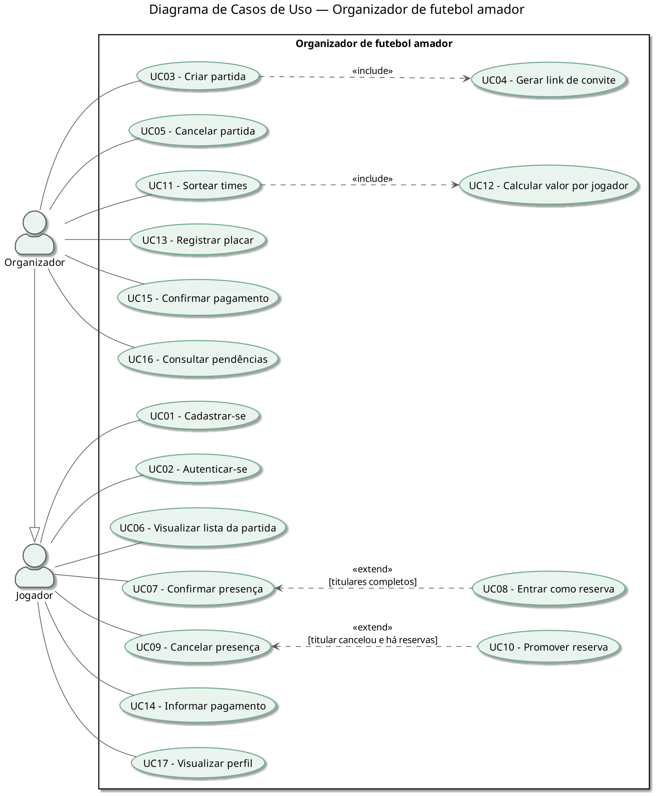

> Fonte do diagrama (PlantUML): [casos_de_uso.puml](diagramas/casos_de_uso.puml)

**Atores**

| Ator | Descrição |
|---|---|
| Jogador | Usuário autenticado que cria partidas, se inscreve nelas, cancela sua presença, informa pagamentos e acompanha seu perfil. |
| Organizador | Papel assumido pelo jogador que criou a partida: cancela a partida, sorteia os times, confirma pagamentos e registra o placar dela (RNF06). Herda todos os casos de uso do Jogador (generalização). |

**Rastreabilidade: casos de uso × requisitos**

| Caso de uso | Ator(es) | Requisitos e regras relacionados |
|---|---|---|
| UC01 - Cadastrar-se | Jogador | RF01, RNF05, RS01 |
| UC02 - Autenticar-se | Jogador | RF02 |
| UC03 - Criar partida | Jogador | RF03, RF04 |
| UC04 - Gerar link de convite | — (incluído em UC03) | RF04 |
| UC05 - Cancelar partida | Organizador | RF05, RN08, RNF06 |
| UC06 - Visualizar lista da partida | Jogador | RF10 |
| UC07 - Confirmar presença | Jogador | RF06, RN01, RN05, RNF02, RNF03, RNF04 |
| UC08 - Entrar como reserva | — (estende UC07) | RF07, RN01, RN02, RNF04 |
| UC09 - Cancelar presença | Jogador | RF08, RN04, RNF03 |
| UC10 - Promover reserva | — (estende UC09) | RF09, RN02 |
| UC11 - Sortear times | Organizador | RF11, RN03, RN05, RN06, RN07, RNF06 |
| UC12 - Calcular valor por jogador | — (incluído em UC11) | RF18, RN03 |
| UC13 - Registrar placar | Organizador | RF15, RNF06 |
| UC14 - Informar pagamento | Jogador | RF12, RNF07 |
| UC15 - Confirmar pagamento | Organizador | RF13, RNF06 |
| UC16 - Consultar pendências | Organizador | RF14, RN04, RNF06 |
| UC17 - Visualizar perfil | Jogador | RF16, RN07 |
| UC18 - Visualizar minhas partidas | Jogador | RF17 |

A tabela repete a linha "Requisitos relacionados" de cada caso de uso (seção 7). Os requisitos RNF01 (interface responsiva), RNF08 (manutenibilidade), RS02 (acesso pelo navegador) e RS03 (interface em português) valem para o sistema inteiro e por isso não estão ligados a um caso de uso específico: RNF01, RS02 e RS03 se refletem no protótipo (seção 12), e RNF08, na organização do modelo de domínio (seção 9).

## 7. Documentação dos Casos de Uso

> Especificação no modelo da disciplina (baseado em BEZERRA, 2014). **Fluxos alternativos (FA)** são caminhos válidos diferentes do fluxo principal; **fluxos de exceção (FE)** tratam erros ou situações que impedem o objetivo do caso de uso. Como no modelo da disciplina, cada fluxo começa pelo passo do fluxo principal em que ocorre, seguido de um título; seus subpassos são numerados a partir desse passo (ex.: 4.1, 4.2) e o último indica para qual passo o fluxo retorna ou que o caso de uso é encerrado. As situações da partida e as transições entre elas estão na máquina de estados (seção 10).

### UC01 - Cadastrar-se

| **Caso de uso** | UC01 - Cadastrar-se |
|---|---|
| **Ator principal** | Jogador (e Organizador, por herança) |
| **Atores secundários** | — |
| **Resumo** | O usuário cria sua conta no sistema informando seus dados pessoais e sua posição preferida. |
| **Pré-condições** | O usuário não possui cadastro no sistema. |
| **Pós-condições** | O usuário está cadastrado e pode se autenticar. |
| **FLUXO PRINCIPAL** | |
| **Fluxo principal** | 1. O usuário acessa a opção "Criar conta". 2. O sistema exibe o formulário de cadastro. 3. O usuário informa nome, telefone, e-mail, senha e posição preferida (linha ou goleiro) e aceita os termos de uso de dados. 4. O sistema valida os dados. 5. O sistema armazena o cadastro, com a senha criptografada. 6. O sistema informa que o cadastro foi realizado e direciona o usuário para a autenticação. |
| **FLUXOS ALTERNATIVOS** | |
| — | Não há. |
| **FLUXOS DE EXCEÇÃO** | |
| **FE01 —** | 4. E-mail já cadastrado 4.1. O sistema informa que o e-mail já está em uso. 4.2. Retorna ao passo 3 do fluxo principal. |
| **FE02 —** | 4. Dados ausentes ou inválidos 4.1. O sistema destaca os campos obrigatórios não preenchidos ou inválidos. 4.2. Retorna ao passo 3 do fluxo principal. |
| **Requisitos relacionados** | RF01, RNF05, RS01 |

### UC02 - Autenticar-se

| **Caso de uso** | UC02 - Autenticar-se |
|---|---|
| **Ator principal** | Jogador (e Organizador, por herança) |
| **Atores secundários** | — |
| **Resumo** | O usuário cadastrado entra no sistema informando e-mail e senha. |
| **Pré-condições** | O usuário não está autenticado. |
| **Pós-condições** | O usuário está autenticado e tem acesso às funcionalidades do seu perfil. |
| **FLUXO PRINCIPAL** | |
| **Fluxo principal** | 1. O usuário acessa o sistema, diretamente ou pelo link de convite de uma partida. 2. O sistema solicita e-mail e senha. 3. O usuário informa e-mail e senha. 4. O sistema valida as credenciais. 5. O sistema autentica o usuário e o direciona para a lista de suas próximas partidas (UC18) ou, se veio pelo link de convite, para a partida do link. |
| **FLUXOS ALTERNATIVOS** | |
| **FA01 —** | 2. Usuário sem cadastro 2.1. O usuário escolhe "Criar conta" e inicia o UC01 - Cadastrar-se. 2.2. O usuário conclui o cadastro. 2.3. Retorna ao passo 2 do fluxo principal. |
| **FLUXOS DE EXCEÇÃO** | |
| **FE01 —** | 4. Credenciais inválidas 4.1. O sistema informa que o e-mail ou a senha estão incorretos. 4.2. Retorna ao passo 3 do fluxo principal. |
| **Requisitos relacionados** | RF02 |

### UC03 - Criar partida

| **Caso de uso** | UC03 - Criar partida |
|---|---|
| **Ator principal** | Jogador (ao criar a partida, passa a ser o Organizador dela) |
| **Atores secundários** | — |
| **Resumo** | O usuário cadastra uma nova partida com data, local, vagas e valor da quadra e recebe o link de convite para compartilhar. Quem cria a partida passa a ser o organizador dela. |
| **Pré-condições** | O usuário está autenticado. |
| **Pós-condições** | A partida está cadastrada com situação *Inscrições abertas*, possui um link de convite e o usuário que a criou consta como seu organizador. |
| **FLUXO PRINCIPAL** | |
| **Fluxo principal** | 1. O usuário acessa a opção "Nova partida". 2. O sistema exibe o formulário da partida. 3. O usuário informa data, horário, local, modalidade (futsal, society ou campo), número de vagas para titulares, número de vagas para reservas e valor total da quadra. 4. O sistema valida os dados. 5. O sistema cadastra a partida com situação *Inscrições abertas*. 6. O sistema executa o UC04 - Gerar link de convite (**include**). 7. O sistema exibe a partida criada com o link de convite e a opção de compartilhá-lo. |
| **FLUXOS ALTERNATIVOS** | |
| — | Não há. |
| **FLUXOS DE EXCEÇÃO** | |
| **FE01 —** | 4. Data e horário no passado 4.1. O sistema informa que a partida deve ser marcada para uma data futura. 4.2. Retorna ao passo 3 do fluxo principal. |
| **FE02 —** | 4. Vagas ou valor inválidos 4.1. O sistema verifica que o número de vagas para titulares é menor que 2, que o número de vagas para reservas é negativo ou que o valor da quadra é menor ou igual a zero. 4.2. O sistema informa o erro. 4.3. Retorna ao passo 3 do fluxo principal. |
| **FE03 —** | 4. Dados ausentes 4.1. O sistema destaca os campos obrigatórios não preenchidos. 4.2. Retorna ao passo 3 do fluxo principal. |
| **Requisitos relacionados** | RF03, RF04 |

### UC04 - Gerar link de convite

| **Caso de uso** | UC04 - Gerar link de convite |
|---|---|
| **Ator principal** | — (incluído em UC03 - Criar partida) |
| **Atores secundários** | — |
| **Resumo** | O sistema gera um link único para a partida, que será compartilhado com os jogadores. |
| **Pré-condições** | A partida foi cadastrada (passo 5 do UC03). |
| **Pós-condições** | A partida possui um link de convite único. |
| **FLUXO PRINCIPAL** | |
| **Fluxo principal** | 1. O sistema gera um código único para a partida. 2. O sistema monta o link de convite a partir desse código. 3. O sistema associa o link à partida e retorna ao UC03. |
| **FLUXOS ALTERNATIVOS** | |
| **FA01 —** | 1. Código já existente 1.1. O sistema verifica que o código gerado já pertence a outra partida. 1.2. Retorna ao passo 1 do fluxo principal, para gerar um novo código. |
| **FLUXOS DE EXCEÇÃO** | |
| — | Não há. |
| **Requisitos relacionados** | RF04 |

### UC05 - Cancelar partida

| **Caso de uso** | UC05 - Cancelar partida |
|---|---|
| **Ator principal** | Organizador |
| **Atores secundários** | — |
| **Resumo** | O organizador cancela uma partida que ainda não foi encerrada. |
| **Pré-condições** | O organizador está autenticado e é o responsável pela partida. A partida ainda não foi encerrada nem cancelada. |
| **Pós-condições** | A partida está com situação *Cancelada* e não aceita mais inscrições, sorteio ou pagamentos; os pagamentos não confirmados estão com situação *Cancelado* (RN08). |
| **FLUXO PRINCIPAL** | |
| **Fluxo principal** | 1. O organizador acessa a partida e escolhe "Cancelar partida". 2. O sistema solicita a confirmação do cancelamento. 3. O organizador confirma. 4. O sistema altera a situação da partida para *Cancelada*. 5. Se os times já foram sorteados, o sistema altera para *Cancelado* os pagamentos da partida que ainda não foram confirmados (RN08). 6. O sistema exibe a partida como cancelada para todos os inscritos. |
| **FLUXOS ALTERNATIVOS** | |
| **FA01 —** | 3. Organizador desiste 3.1. O organizador não confirma o cancelamento. 3.2. O caso de uso é encerrado sem alterações. |
| **FLUXOS DE EXCEÇÃO** | |
| — | Não há. |
| **Requisitos relacionados** | RF05, RN08, RNF06 |

### UC06 - Visualizar lista da partida

| **Caso de uso** | UC06 - Visualizar lista da partida |
|---|---|
| **Ator principal** | Jogador (e Organizador, por herança) |
| **Atores secundários** | — |
| **Resumo** | O jogador consulta os dados da partida, os titulares, a fila de reservas e as vagas restantes. |
| **Pré-condições** | O jogador está autenticado. |
| **Pós-condições** | Nenhuma alteração no sistema. |
| **FLUXO PRINCIPAL** | |
| **Fluxo principal** | 1. O jogador acessa a partida pelo link de convite ou pela lista de suas partidas (UC18). 2. O sistema exibe data, horário, local, modalidade e situação da partida. 3. O sistema exibe a lista de titulares e a fila de reservas, na ordem de inscrição. 4. O sistema exibe a quantidade de vagas restantes para titulares e reservas. |
| **FLUXOS ALTERNATIVOS** | |
| **FA01 —** | 3. Times já sorteados 3.1. O sistema exibe, além da lista, a composição de cada time e o valor por jogador. 3.2. Retorna ao passo 4 do fluxo principal. |
| **FLUXOS DE EXCEÇÃO** | |
| **FE01 —** | 1. Link inválido 1.1. O sistema verifica que o link não corresponde a nenhuma partida. 1.2. O sistema informa que a partida não foi encontrada. 1.3. O caso de uso é encerrado. |
| **Requisitos relacionados** | RF10 |

### UC07 - Confirmar presença

| **Caso de uso** | UC07 - Confirmar presença |
|---|---|
| **Ator principal** | Jogador (e Organizador, por herança) |
| **Atores secundários** | — |
| **Resumo** | O jogador se inscreve na partida pelo link de convite, ocupando uma vaga de titular ou, se não houver, de reserva. |
| **Pré-condições** | O jogador está autenticado e ainda não está inscrito na partida. |
| **Pós-condições** | O jogador está inscrito na partida como titular ou como reserva; se a inscrição preencheu a última vaga da partida, ela está com situação *Lotada*. |
| **FLUXO PRINCIPAL** | |
| **Fluxo principal** | 1. O jogador acessa a partida pelo link de convite ou pela lista de suas partidas (UC18). 2. O sistema exibe os dados da partida e a opção "Confirmar presença". 3. O jogador escolhe "Confirmar presença". 4. O sistema verifica se há vaga de titular. 5. O sistema inscreve o jogador como titular, registrando a data e a hora da inscrição. 6. O sistema exibe a lista atualizada, com o jogador entre os titulares. |
| **FLUXOS ALTERNATIVOS** | |
| **FA01 —** | 4. Titulares completos 4.1. O sistema verifica que não há vaga de titular, mas há vaga de reserva. 4.2. O sistema executa o UC08 - Entrar como reserva (**extend**). 4.3. O caso de uso é encerrado. |
| **FA02 —** | 4. Confirmações simultâneas 4.1. Outro jogador confirma presença ao mesmo tempo, disputando a mesma vaga. 4.2. O sistema processa um pedido de cada vez, de forma que o número de inscritos nunca ultrapasse o número de vagas (RNF04). 4.3. Retorna ao passo 4 do fluxo principal. As vagas já estão atualizadas. |
| **FA03 —** | 5. Última vaga da partida 5.1. O sistema verifica que a inscrição preencheu a última vaga de titular e que a partida não tem vagas de reserva. 5.2. O sistema altera a situação da partida para *Lotada* (RN01). 5.3. Retorna ao passo 6 do fluxo principal. |
| **FLUXOS DE EXCEÇÃO** | |
| **FE01 —** | 2. Partida lotada 2.1. O sistema verifica que titulares e reservas estão completos. 2.2. O sistema não exibe a opção "Confirmar presença" e informa que a partida está lotada (RN01). 2.3. O caso de uso é encerrado. |
| **FE02 —** | 2. Inscrições encerradas 2.1. O sistema verifica que os times já foram sorteados, que a partida foi cancelada ou que a data e o horário da partida já passaram. 2.2. O sistema não exibe a opção "Confirmar presença" e informa o motivo (RN05). 2.3. O caso de uso é encerrado. |
| **FE03 —** | 4. Vagas esgotadas durante a confirmação 4.1. O sistema verifica que, entre a exibição da partida e a confirmação, titulares e reservas ficaram completos. 4.2. O sistema informa que a partida lotou e não realiza a inscrição (RN01, RNF04). 4.3. O caso de uso é encerrado. |
| **Requisitos relacionados** | RF06, RN01, RN05, RNF02, RNF03, RNF04 |

### UC08 - Entrar como reserva

| **Caso de uso** | UC08 - Entrar como reserva |
|---|---|
| **Ator principal** | — (estende UC07 - Confirmar presença) |
| **Atores secundários** | — |
| **Resumo** | Quando as vagas de titulares estão completas, o sistema inscreve o jogador no final da fila de reservas. Ponto de extensão: passo 4 do UC07. |
| **Pré-condições** | As vagas de titulares estão completas e há vaga de reserva. |
| **Pós-condições** | O jogador está inscrito como reserva, no final da fila; se ocupou a última vaga de reserva, a partida está com situação *Lotada*. |
| **FLUXO PRINCIPAL** | |
| **Fluxo principal** | 1. O sistema informa ao jogador que as vagas de titulares estão completas. 2. O sistema inscreve o jogador como reserva, registrando a data e a hora da inscrição. 3. O sistema informa a posição do jogador na fila de reservas e retorna ao UC07. |
| **FLUXOS ALTERNATIVOS** | |
| **FA01 —** | 2. Reservas completas após a inscrição 2.1. O sistema verifica que a inscrição preencheu a última vaga de reserva. 2.2. O sistema altera a situação da partida para *Lotada* (RN01). 2.3. Retorna ao passo 3 do fluxo principal. |
| **FLUXOS DE EXCEÇÃO** | |
| — | Não há. |
| **Requisitos relacionados** | RF07, RN01, RN02, RNF04 |

### UC09 - Cancelar presença

| **Caso de uso** | UC09 - Cancelar presença |
|---|---|
| **Ator principal** | Jogador (e Organizador, por herança) |
| **Atores secundários** | — |
| **Resumo** | O jogador desiste da partida, liberando sua vaga para um reserva ou para novas inscrições. |
| **Pré-condições** | O jogador está autenticado e inscrito na partida. |
| **Pós-condições** | A inscrição do jogador está cancelada e sua vaga foi liberada ou ocupada por um reserva; se o cancelamento ocorreu após o sorteio, o pagamento da sua parte é mantido (RN04). |
| **FLUXO PRINCIPAL** | |
| **Fluxo principal** | 1. O jogador acessa a partida e escolhe "Cancelar presença". 2. O sistema solicita a confirmação. 3. O jogador confirma. 4. O sistema cancela a inscrição do jogador. 5. O sistema verifica que o jogador era titular e que não há reservas na fila: a vaga de titular fica livre e, se a partida estava *Lotada*, sua situação volta para *Inscrições abertas*. 6. O sistema exibe a lista atualizada. |
| **FLUXOS ALTERNATIVOS** | |
| **FA01 —** | 5. Era titular e há reservas 5.1. O sistema executa o UC10 - Promover reserva (**extend**). 5.2. Retorna ao passo 6 do fluxo principal. |
| **FA02 —** | 5. Era reserva 5.1. O sistema retira o jogador da fila de reservas, e os reservas seguintes avançam uma posição. 5.2. Se a partida estava *Lotada*, o sistema altera sua situação para *Inscrições abertas*. 5.3. Retorna ao passo 6 do fluxo principal. |
| **FA03 —** | 2. Cancelamento após o sorteio 2.1. Junto com a confirmação, o sistema avisa que o jogador continua responsável pelo pagamento da sua parte (RN04). 2.2. O jogador confirma (se não confirmar, segue o FA04). 2.3. O sistema cancela a inscrição e mantém o pagamento já registrado para ela. 2.4. Retorna ao passo 5 do fluxo principal. |
| **FA04 —** | 3. Jogador desiste 3.1. O jogador não confirma o cancelamento. 3.2. O caso de uso é encerrado sem alterações. |
| **FLUXOS DE EXCEÇÃO** | |
| **FE01 —** | 1. Prazo para cancelar encerrado 1.1. O sistema verifica que a data e o horário da partida já passaram ou que a partida foi encerrada ou cancelada. 1.2. O sistema não exibe a opção "Cancelar presença". 1.3. O caso de uso é encerrado. |
| **Requisitos relacionados** | RF08, RN04, RNF03 |

### UC10 - Promover reserva

| **Caso de uso** | UC10 - Promover reserva |
|---|---|
| **Ator principal** | — (estende UC09 - Cancelar presença) |
| **Atores secundários** | — |
| **Resumo** | Quando um titular cancela, o sistema passa o primeiro reserva da fila para titular. Ponto de extensão: passo 5 do UC09. |
| **Pré-condições** | Um titular cancelou a presença e existe ao menos um reserva na fila. |
| **Pós-condições** | O primeiro reserva da fila passou a ser titular. |
| **FLUXO PRINCIPAL** | |
| **Fluxo principal** | 1. O sistema identifica o primeiro reserva da fila, pela data e hora da inscrição (RN02). 2. O sistema altera a inscrição desse jogador de reserva para titular, e os reservas seguintes avançam uma posição na fila. 3. Se a partida estava *Lotada*, o sistema altera sua situação para *Inscrições abertas*, pois abriu uma vaga de reserva, e retorna ao UC09. |
| **FLUXOS ALTERNATIVOS** | |
| **FA01 —** | 2. Times já sorteados 2.1. Além do passo 2, o jogador promovido assume a vaga do titular que cancelou, no mesmo time. 2.2. A partida continua com situação *Times sorteados*, e o passo 3 do fluxo principal não é executado. 2.3. O caso de uso é encerrado e o fluxo volta ao UC09. |
| **FLUXOS DE EXCEÇÃO** | |
| — | Não há. |
| **Requisitos relacionados** | RF09, RN02 |

### UC11 - Sortear times

| **Caso de uso** | UC11 - Sortear times |
|---|---|
| **Ator principal** | Organizador |
| **Atores secundários** | — |
| **Resumo** | O organizador sorteia aleatoriamente os titulares entre os times, o que encerra as inscrições e define o valor por jogador. |
| **Pré-condições** | O organizador está autenticado e é o responsável pela partida. A partida está com situação *Inscrições abertas*, *Lotada* ou, para sortear de novo, *Times sorteados*. |
| **Pós-condições** | Os times estão definidos, a partida está com situação *Times sorteados*, as inscrições estão encerradas e o valor por jogador está calculado. |
| **FLUXO PRINCIPAL** | |
| **Fluxo principal** | 1. O organizador acessa a partida e escolhe "Sortear times". 2. O sistema solicita a confirmação, informando que as inscrições serão encerradas. 3. O organizador confirma. 4. O sistema distribui os goleiros, um por time, enquanto houver goleiros disponíveis (RN06). 5. O sistema distribui aleatoriamente os demais titulares entre os 2 times, de forma que um time tenha no máximo um jogador a mais que o outro (RN07). 6. O sistema executa o UC12 - Calcular valor por jogador (**include**). 7. O sistema altera a situação da partida para *Times sorteados* (RN05). 8. O sistema exibe os times sorteados e o valor por jogador. |
| **FLUXOS ALTERNATIVOS** | |
| **FA01 —** | 3. Organizador desiste 3.1. O organizador não confirma o sorteio. 3.2. O caso de uso é encerrado sem alterações. |
| **FA02 —** | 4. Nenhum goleiro entre os titulares 4.1. O sistema verifica que nenhum titular tem goleiro como posição preferida. 4.2. O sistema não faz a distribuição de goleiros. 4.3. Retorna ao passo 5 do fluxo principal, em que todos os titulares são distribuídos aleatoriamente. |
| **FA03 —** | 1. Sortear novamente 1.1. A partida já está com situação *Times sorteados*, e o organizador escolhe "Sortear de novo". 1.2. O sistema solicita a confirmação, informando que o valor por jogador não muda. 1.3. O organizador confirma. 1.4. O sistema repete os passos 4 e 5 do fluxo principal, sem executar o UC12: o valor por jogador e os pagamentos já registrados são mantidos (RN03). 1.5. Retorna ao passo 8 do fluxo principal. |
| **FLUXOS DE EXCEÇÃO** | |
| **FE01 —** | 1. Titulares insuficientes 1.1. O sistema verifica que a partida tem menos de 2 titulares. 1.2. O sistema informa que não é possível sortear os times. 1.3. O caso de uso é encerrado. |
| **Requisitos relacionados** | RF11, RN03, RN05, RN06, RN07, RNF06 |

### UC12 - Calcular valor por jogador

| **Caso de uso** | UC12 - Calcular valor por jogador |
|---|---|
| **Ator principal** | — (incluído em UC11 - Sortear times) |
| **Atores secundários** | — |
| **Resumo** | O sistema divide o valor da quadra entre todos os inscritos e registra o pagamento pendente de cada um. |
| **Pré-condições** | Os titulares foram distribuídos entre os times (passo 5 do UC11). |
| **Pós-condições** | Cada inscrito possui um pagamento *Pendente* com o valor da sua parte. |
| **FLUXO PRINCIPAL** | |
| **Fluxo principal** | 1. O sistema conta os inscritos da partida (titulares e reservas). 2. O sistema divide o valor total da quadra pelo número de inscritos, arredondando para cima no centavo (RN03). 3. O sistema grava o valor por jogador na partida, registra para cada inscrito um pagamento com situação *Pendente* e o valor calculado e retorna ao UC11. |
| **FLUXOS ALTERNATIVOS** | |
| — | Não há. O UC12 é executado apenas no primeiro sorteio; um novo sorteio (UC11, FA03) não recalcula o valor (RN03). |
| **FLUXOS DE EXCEÇÃO** | |
| — | Não há. |
| **Requisitos relacionados** | RF18, RN03 |

### UC13 - Registrar placar

| **Caso de uso** | UC13 - Registrar placar |
|---|---|
| **Ator principal** | Organizador |
| **Atores secundários** | — |
| **Resumo** | Após o jogo, o organizador informa os gols de cada time e encerra a partida. |
| **Pré-condições** | O organizador está autenticado e é o responsável pela partida. A partida está com situação *Times sorteados* e a data e o horário da partida já passaram. |
| **Pós-condições** | O placar está registrado e a partida está com situação *Encerrada*. |
| **FLUXO PRINCIPAL** | |
| **Fluxo principal** | 1. O organizador acessa a partida e escolhe "Registrar placar". 2. O sistema exibe os campos de gols do Time A e do Time B. 3. O organizador informa a quantidade de gols de cada time. 4. O sistema valida os valores. 5. O sistema registra o placar e altera a situação da partida para *Encerrada*. 6. O sistema exibe o resultado final. |
| **FLUXOS ALTERNATIVOS** | |
| — | Não há. |
| **FLUXOS DE EXCEÇÃO** | |
| **FE01 —** | 4. Valor inválido 4.1. O sistema verifica que algum valor é negativo ou não numérico. 4.2. O sistema informa o erro. 4.3. Retorna ao passo 3 do fluxo principal. |
| **Requisitos relacionados** | RF15, RNF06 |

### UC14 - Informar pagamento

| **Caso de uso** | UC14 - Informar pagamento |
|---|---|
| **Ator principal** | Jogador (e Organizador, por herança) |
| **Atores secundários** | — |
| **Resumo** | O jogador anexa o comprovante do pagamento da sua parte para que o organizador confirme. |
| **Pré-condições** | O jogador está autenticado e possui um pagamento em uma partida (o pagamento é criado no sorteio dos times). |
| **Pós-condições** | O pagamento está com situação *Informado*, com o comprovante anexado, aguardando a confirmação do organizador. |
| **FLUXO PRINCIPAL** | |
| **Fluxo principal** | 1. O jogador acessa a partida ou seu perfil e escolhe "Informar pagamento". 2. O sistema exibe o valor a pagar. 3. O jogador anexa o comprovante. 4. O sistema valida o arquivo. 5. O sistema registra o comprovante e altera a situação do pagamento para *Informado*. 6. O sistema exibe o pagamento como aguardando confirmação do organizador. |
| **FLUXOS ALTERNATIVOS** | |
| — | Não há. |
| **FLUXOS DE EXCEÇÃO** | |
| **FE01 —** | 4. Arquivo inválido 4.1. O sistema verifica que o arquivo não é JPG, PNG ou PDF, ou que tem mais de 5 MB (RNF07). 4.2. O sistema informa o erro. 4.3. Retorna ao passo 3 do fluxo principal. |
| **FE02 —** | 1. Pagamento não está pendente 1.1. O sistema verifica que o pagamento já foi informado, confirmado ou cancelado. 1.2. O sistema exibe a situação do pagamento e não exibe a opção "Informar pagamento". 1.3. O caso de uso é encerrado. |
| **Requisitos relacionados** | RF12, RNF07 |

### UC15 - Confirmar pagamento

| **Caso de uso** | UC15 - Confirmar pagamento |
|---|---|
| **Ator principal** | Organizador |
| **Atores secundários** | — |
| **Resumo** | O organizador confere o comprovante de um jogador e confirma o pagamento, ou registra manualmente um pagamento recebido fora do sistema. |
| **Pré-condições** | O organizador está autenticado e é o responsável pela partida. A partida possui pagamentos *Pendentes* ou *Informados*. |
| **Pós-condições** | O pagamento do jogador está com situação *Confirmado* ou, se o comprovante foi recusado (FA02), novamente *Pendente*. |
| **FLUXO PRINCIPAL** | |
| **Fluxo principal** | 1. O organizador acessa os pagamentos da partida. 2. O sistema lista os inscritos com o valor e a situação de cada pagamento. 3. O organizador seleciona um pagamento *Informado* e visualiza o comprovante. 4. O organizador escolhe "Confirmar". 5. O sistema altera a situação do pagamento para *Confirmado* e registra a data da confirmação. |
| **FLUXOS ALTERNATIVOS** | |
| **FA01 —** | 3. Registro manual 3.1. O organizador seleciona o pagamento *Pendente* de um jogador que pagou fora do sistema. 3.2. O organizador escolhe "Registrar pagamento". 3.3. Retorna ao passo 5 do fluxo principal, sem comprovante. |
| **FA02 —** | 4. Comprovante recusado 4.1. O organizador escolhe "Recusar". 4.2. O sistema descarta o comprovante e altera a situação do pagamento para *Pendente*, para que o jogador possa informá-lo de novo (UC14). 4.3. Retorna ao passo 2 do fluxo principal. |
| **FLUXOS DE EXCEÇÃO** | |
| — | Não há. |
| **Requisitos relacionados** | RF13, RNF06 |

### UC16 - Consultar pendências

| **Caso de uso** | UC16 - Consultar pendências |
|---|---|
| **Ator principal** | Organizador |
| **Atores secundários** | — |
| **Resumo** | O organizador consulta quem ainda não pagou em cada uma das suas partidas e o total a receber. |
| **Pré-condições** | O organizador está autenticado e é o responsável por ao menos uma partida. |
| **Pós-condições** | Nenhuma alteração no sistema. |
| **FLUXO PRINCIPAL** | |
| **Fluxo principal** | 1. O organizador acessa a opção "Pendências". 2. O sistema lista as partidas do organizador que possuem pagamentos *Pendentes* ou *Informados*. 3. Para cada partida, o sistema exibe os jogadores com pagamento *Pendente* ou *Informado* e o valor devido, inclusive os que cancelaram a presença após o sorteio (RN04). 4. O sistema exibe o total a receber. |
| **FLUXOS ALTERNATIVOS** | |
| **FA01 —** | 2. Nenhuma pendência 2.1. O sistema verifica que não há pagamentos *Pendentes* ou *Informados*. 2.2. O sistema informa que não há pagamentos a receber. 2.3. O caso de uso é encerrado. |
| **FA02 —** | 3. Confirmar a partir das pendências 3.1. O organizador seleciona uma partida e escolhe "Ver pagamentos da partida". 3.2. O organizador é levado aos pagamentos da partida, onde inicia o UC15 - Confirmar pagamento. 3.3. Retorna ao passo 2 do fluxo principal. |
| **FLUXOS DE EXCEÇÃO** | |
| — | Não há. |
| **Requisitos relacionados** | RF14, RN04, RNF06 |

### UC17 - Visualizar perfil

| **Caso de uso** | UC17 - Visualizar perfil |
|---|---|
| **Ator principal** | Jogador (e Organizador, por herança) |
| **Atores secundários** | — |
| **Resumo** | O jogador consulta seus dados, seu histórico de partidas e seus pagamentos pendentes. |
| **Pré-condições** | O jogador está autenticado. |
| **Pós-condições** | Nenhuma alteração no sistema. |
| **FLUXO PRINCIPAL** | |
| **Fluxo principal** | 1. O jogador acessa a opção "Perfil". 2. O sistema exibe nome, telefone, e-mail e posição preferida. 3. O sistema exibe o histórico de partidas *Encerradas* das quais o jogador participou, com data, local, time (ou "reserva", para quem participou como reserva, já que reservas não pertencem a um time fixo — RN07) e placar. 4. O sistema exibe os pagamentos do jogador com situação *Pendente* ou *Informado*. |
| **FLUXOS ALTERNATIVOS** | |
| **FA01 —** | 3. Nenhuma partida disputada 3.1. O sistema informa que o jogador ainda não participou de partidas. 3.2. Retorna ao passo 4 do fluxo principal. |
| **FA02 —** | 4. Nenhuma pendência 4.1. O sistema informa que não há pagamentos pendentes. 4.2. O caso de uso é encerrado. |
| **FLUXOS DE EXCEÇÃO** | |
| — | Não há. |
| **Requisitos relacionados** | RF16, RN07 |

### UC18 - Visualizar minhas partidas

| **Caso de uso** | UC18 - Visualizar minhas partidas |
|---|---|
| **Ator principal** | Jogador (e Organizador, por herança) |
| **Atores secundários** | — |
| **Resumo** | O usuário consulta as próximas partidas em que está inscrito ou que organiza e acessa qualquer uma delas sem depender do link de convite. |
| **Pré-condições** | O usuário está autenticado. |
| **Pós-condições** | Nenhuma alteração no sistema, exceto quando o usuário cria uma partida pelo FA02 (UC03). |
| **FLUXO PRINCIPAL** | |
| **Fluxo principal** | 1. O usuário acessa a opção "Início". 2. O sistema lista as partidas ainda não encerradas nem canceladas em que o usuário está inscrito ou que organiza, ordenadas pela data e horário. 3. Para cada partida, o sistema exibe data, horário, local, modalidade, situação e vagas restantes, identificando as partidas que o usuário organiza, e a opção "Nova partida". 4. O usuário seleciona uma partida. 5. O sistema exibe a partida selecionada, e o usuário segue no UC06 - Visualizar lista da partida. |
| **FLUXOS ALTERNATIVOS** | |
| **FA01 —** | 2. Nenhuma partida em aberto 2.1. O sistema informa que o usuário não tem partidas em aberto. 2.2. O caso de uso é encerrado; a opção "Nova partida" continua disponível (FA02). |
| **FA02 —** | 4. Criar partida 4.1. O usuário escolhe "Nova partida" e é levado ao formulário de criação, onde inicia o UC03 - Criar partida. 4.2. O caso de uso é encerrado. |
| **FLUXOS DE EXCEÇÃO** | |
| — | Não há. |
| **Requisitos relacionados** | RF17 |

---

# Parte III — Modelagem

## 8. Diagrama de Classes — Modelo Conceitual

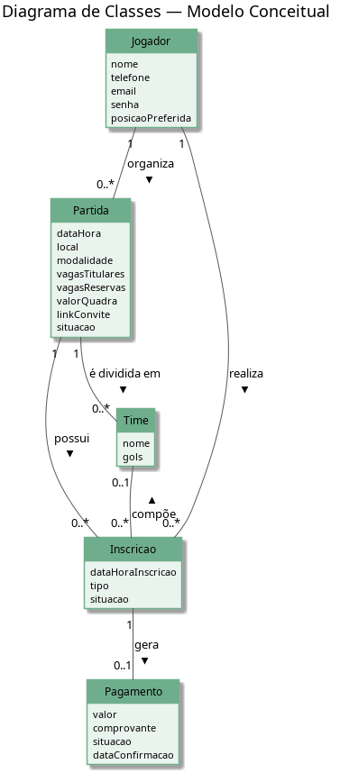

> Fonte do diagrama (PlantUML): [classes_conceitual.puml](diagramas/classes_conceitual.puml)

O modelo conceitual representa as entidades do domínio e seus relacionamentos, sem detalhes de implementação (tipos, métodos e navegabilidade são definidos no modelo de domínio).

**Classes**

| Classe | Descrição | Origem |
|---|---|---|
| Jogador | Pessoa cadastrada no sistema, com o registro do aceite do uso dos dados (RS01). Um jogador que cria partidas atua como organizador delas. | RF01, RF02, RS01 |
| Partida | Jogo marcado em uma data, horário e local, com limite de vagas, valor da quadra e o valor por jogador definido no primeiro sorteio. | RF03, RF04, RF05, RF18 |
| Inscricao | Participação de um jogador em uma partida, como titular ou reserva. Guarda a data e a hora da inscrição, que definem a ordem da fila de reservas. | RF06–RF09, RN01, RN02 |
| Time | Equipe formada no sorteio, com o número de gols marcados na partida. Cada partida sorteada tem exatamente 2 times. | RF11, RF15, RN06, RN07 |
| Pagamento | Parte do valor da quadra devida por um inscrito, com o comprovante e a situação (pendente, informado, confirmado ou cancelado). | RF12–RF14, RN03, RN04, RN08 |

**Associações**

| Associação | Multiplicidade | Significado |
|---|---|---|
| Jogador *organiza* Partida | 1 — 0..* | Toda partida tem um organizador; um jogador pode organizar nenhuma ou várias partidas. |
| Jogador *realiza* Inscricao | 1 — 0..* | Cada inscrição pertence a um jogador; um jogador pode se inscrever em várias partidas. |
| Partida *possui* Inscricao | 1 — 0..* | Cada inscrição é de uma partida; a partida começa sem inscritos. |
| Partida *é dividida em* Time | 1 — 0..2 | Antes do sorteio a partida não tem times; após o sorteio, tem exatamente 2 (RN07). |
| Inscricao *compõe* Time | 0..* — 0..1 | Um time é composto por inscrições de titulares; reservas (que revezam com os dois times) e inscrições anteriores ao sorteio não pertencem a nenhum time (RN07). |
| Inscricao *gera* Pagamento | 1 — 0..1 | O pagamento é criado no sorteio (RN03), por isso a inscrição pode ainda não ter pagamento. |

**Decisões de modelagem**

- **Organizador não é uma classe separada.** No diagrama de casos de uso, Organizador é uma especialização de Jogador. No domínio, ser organizador é um papel, representado pela associação *organiza*: o mesmo jogador pode organizar uma partida e jogar como inscrito em outra.
- **Inscricao é uma classe, e não apenas uma lista de jogadores na partida**, porque a participação tem dados próprios (data e hora, tipo e situação) e se relaciona com Time e Pagamento.
- **O pagamento é por inscrição, e não por jogador**, porque o valor é calculado para cada partida (RN03).

## 9. Diagrama de Classes — Modelo de Domínio

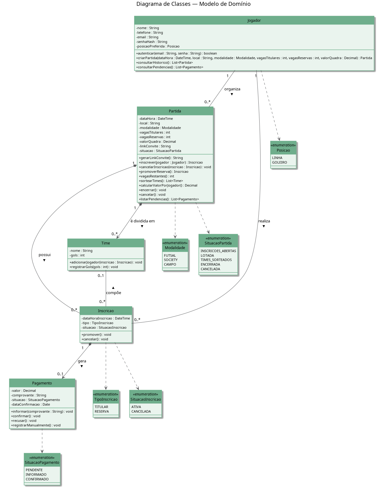

> Fonte do diagrama (PlantUML): [classes_dominio.puml](diagramas/classes_dominio.puml)

O modelo de domínio detalha o modelo conceitual com os tipos dos atributos, os métodos relevantes, as multiplicidades e a navegabilidade das associações.

**Convenções**

- `-` atributo privado; `+` método público.
- Associação **sem seta**: navegável nos dois sentidos. Associação **com seta**: navegável apenas no sentido da seta.
- **Losango preenchido** (composição): a parte só existe enquanto o todo existir. Inscrições e times pertencem a uma partida, e o pagamento pertence a uma inscrição.
- Os valores fixos dos atributos (posição, modalidade e situações) são representados por **enumerações**.
- `Decimal` é usado para valores monetários, evitando erros de arredondamento de ponto flutuante (RN03).
- Os tipos são genéricos, sem amarrar o modelo a uma linguagem: `String`, `int`, `boolean`, `Decimal`, `DateTime` (data e hora) e `Date` (só a data, usada na data de confirmação do pagamento).
- `valorPorJogador` é gravado por `calcularValorPorJogador()` no primeiro sorteio e não muda nos sorteios seguintes (RN03).
- Na tabela de métodos abaixo, os métodos aparecem só pelo nome; as assinaturas completas (parâmetros e retorno) estão no diagrama.

**Navegabilidade**

| Associação | Navegabilidade | Justificativa |
|---|---|---|
| Jogador *organiza* Partida | Bidirecional | A partida precisa saber quem é seu organizador para validar as permissões (RNF06); o organizador precisa listar suas partidas para consultar pendências (UC16) e ver as próximas partidas (UC18). |
| Jogador *realiza* Inscricao | Bidirecional | A lista da partida exibe o nome de cada inscrito (UC06); o jogador lista suas inscrições para montar o histórico (UC17) e as próximas partidas (UC18). |
| Partida *possui* Inscricao | Bidirecional (composição) | A partida controla vagas e fila de reservas a partir das inscrições (UC07–UC10); o histórico do jogador precisa chegar à partida a partir da inscrição (UC17). |
| Partida *é dividida em* Time | Partida → Time (composição) | Os times são acessados sempre a partir da partida (UC06, UC11, UC13); o time não precisa conhecer a partida. |
| Inscricao *compõe* Time | Bidirecional | O time lista seus jogadores (UC06); a inscrição precisa saber seu time para o reserva promovido assumir a vaga no mesmo time (UC10, FA01) e para o histórico (UC17). |
| Inscricao *gera* Pagamento | Inscricao → Pagamento (composição) | O pagamento é sempre acessado a partir da inscrição, que leva ao jogador e à partida (UC14–UC17). Por isso, as consultas de pendências devolvem inscrições, e não pagamentos soltos. |

**Métodos × casos de uso**

| Classe | Método | Caso de uso |
|---|---|---|
| Jogador | `autenticar()` | UC02 |
| Jogador | `criarPartida()` | UC03 |
| Jogador | `consultarHistorico()` | UC17 |
| Jogador | `consultarProximasPartidas()` | UC18 |
| Jogador | `consultarPagamentosPendentes()` | UC14, UC17 |
| Partida | `gerarLinkConvite()` | UC04 |
| Partida | `inscrever()` | UC07, UC08 |
| Partida | `cancelarInscricao()` | UC09 |
| Partida | `promoverReserva()` | UC10 |
| Partida | `vagasRestantes()` | UC06, UC07, UC18 |
| Partida | `sortearTimes()` | UC11 |
| Partida | `calcularValorPorJogador()` | UC11, UC12 |
| Partida | `encerrar()` | UC13 |
| Partida | `cancelar()` | UC05 |
| Partida | `listarPendencias()` | UC16 |
| Inscricao | `promover()` | UC10 |
| Inscricao | `cancelar()` | UC09 |
| Time | `adicionarJogador()` | UC10, UC11 |
| Time | `registrarGols()` | UC13 |
| Pagamento | `informar()` | UC14 |
| Pagamento | `confirmar()` | UC15 |
| Pagamento | `recusar()` | UC15 |
| Pagamento | `registrarManualmente()` | UC15 |
| Pagamento | `cancelar()` | UC05 |

O cadastro (UC01) não aparece como método de Jogador porque é a própria criação do objeto (construtor).

## 10. Segundo Diagrama UML — Máquina de Estados da Partida

**Por que este diagrama:** a Partida é a entidade central do sistema e a que tem o ciclo de vida mais rico. O que pode ser feito com ela (inscrever, sortear, cancelar, encerrar) depende da situação em que ela está, e essas restrições aparecem em várias regras de negócio e casos de uso. O diagrama de máquina de estados deixa essas regras explícitas em um único lugar.

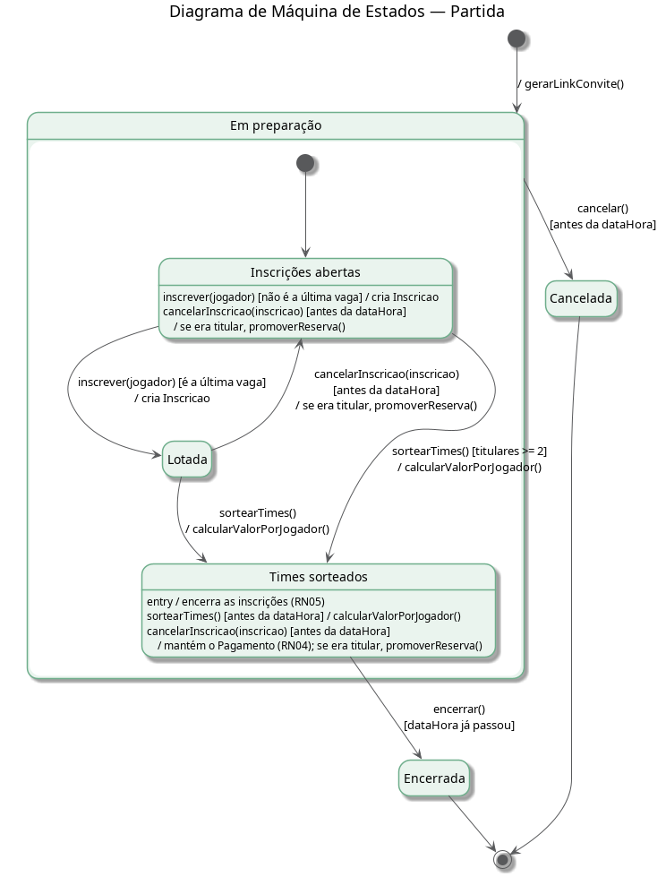

> Fonte do diagrama (PlantUML): [maquina_estados_partida.puml](diagramas/maquina_estados_partida.puml)

**Notação**

- Transições no formato `evento [guarda] / ação`. Os eventos são métodos da classe Partida definidos no modelo de domínio (seção 9); as ações descrevem o efeito da transição e, quando ele corresponde a um método, usam o nome desse método.
- **Transições internas** (escritas dentro do estado) tratam o evento sem mudar de estado. A atividade `entry` é executada sempre que o estado é alcançado.
- **Em preparação** é um **estado composto** que agrupa os estados anteriores ao jogo. A transição `cancelar()` sai da borda do estado composto e, por isso, vale para qualquer um dos seus subestados.

**Estados**

| Estado | Valor em `SituacaoPartida` | Descrição |
|---|---|---|
| Inscrições abertas | `INSCRICOES_ABERTAS` | A partida aceita inscrições, como titular ou reserva, até a data e o horário da partida. |
| Lotada | `LOTADA` | Titulares e reservas estão completos; novas inscrições não são aceitas (RN01). |
| Times sorteados | `TIMES_SORTEADOS` | Os times foram definidos, as inscrições estão encerradas (RN05) e o valor por jogador está calculado (RN03). |
| Encerrada | `ENCERRADA` | O placar foi registrado. Estado terminal (sem transições de saída). |
| Cancelada | `CANCELADA` | O organizador cancelou a partida antes de encerrá-la; os pagamentos não confirmados foram cancelados (RN08). Estado terminal (sem transições de saída). |

**Transições**

| Origem → Destino | Evento [guarda] / ação | Caso de uso / Regra |
|---|---|---|
| Início → Inscrições abertas | / `gerarLinkConvite()` | UC03, UC04 |
| Inscrições abertas (interna) | `inscrever(jogador)` [antes da dataHora e não é a última vaga] / cria Inscricao | UC07, UC08 |
| Inscrições abertas → Lotada | `inscrever(jogador)` [antes da dataHora e é a última vaga] / cria Inscricao | UC07 (FA03), UC08 (FA01), RN01 |
| Inscrições abertas (interna) | `cancelarInscricao(inscricao)` [antes da dataHora] / se era titular, `promoverReserva()` | UC09, UC10, RN02 |
| Lotada → Inscrições abertas | `cancelarInscricao(inscricao)` [antes da dataHora] / se era titular, `promoverReserva()` | UC09, UC10, RN02 |
| Inscrições abertas → Times sorteados | `sortearTimes()` [titulares >= 2] / `calcularValorPorJogador()` | UC11, UC12, RN03, RN05, RN07 |
| Lotada → Times sorteados | `sortearTimes()` / `calcularValorPorJogador()` | UC11, UC12, RN03, RN05, RN07 |
| Times sorteados (interna) | `sortearTimes()` / redistribui os times, mantendo o valor | UC11 (FA03), RN03 |
| Times sorteados (interna) | `cancelarInscricao(inscricao)` [antes da dataHora] / mantém o Pagamento; se era titular, `promoverReserva()` | UC09 (FA03), UC10 (FA01), RN04 |
| Times sorteados → Encerrada | `encerrar()` [dataHora já passou] | UC13 |
| Em preparação → Cancelada | `cancelar()` / cancela os pagamentos não confirmados | UC05, RN08 |

**Observações**

- **Regra de tempo única.** O início da partida não é um estado separado: ele é determinado pela guarda de tempo (`dataHora`). Até a data e o horário da partida, os jogadores podem se inscrever e cancelar a presença. Enquanto a partida não for encerrada, o organizador pode sortear os times e cancelar a partida, inclusive depois do horário, quando o jogo não aconteceu (chuva, quadra fechada) e o placar ainda não foi registrado. Somente depois da data e do horário a partida pode ser encerrada.
- **Nenhum estado fica sem saída.** De qualquer estado de *Em preparação* a partida pode ser cancelada, a qualquer momento. Por isso, uma partida que chega ao horário sem titulares suficientes para o sorteio não fica presa: o organizador a cancela.
- A partida só chega a *Lotada* a partir de *Inscrições abertas*, e sai dela quando qualquer inscrito cancela, porque sempre abre uma vaga (de titular ou, após a promoção de um reserva, de reserva).
- Não existe transição de *Times sorteados* de volta para *Inscrições abertas*: após o sorteio, as inscrições ficam encerradas (RN05).

---

# Parte IV — Protótipo

## 11. Mapa do Site

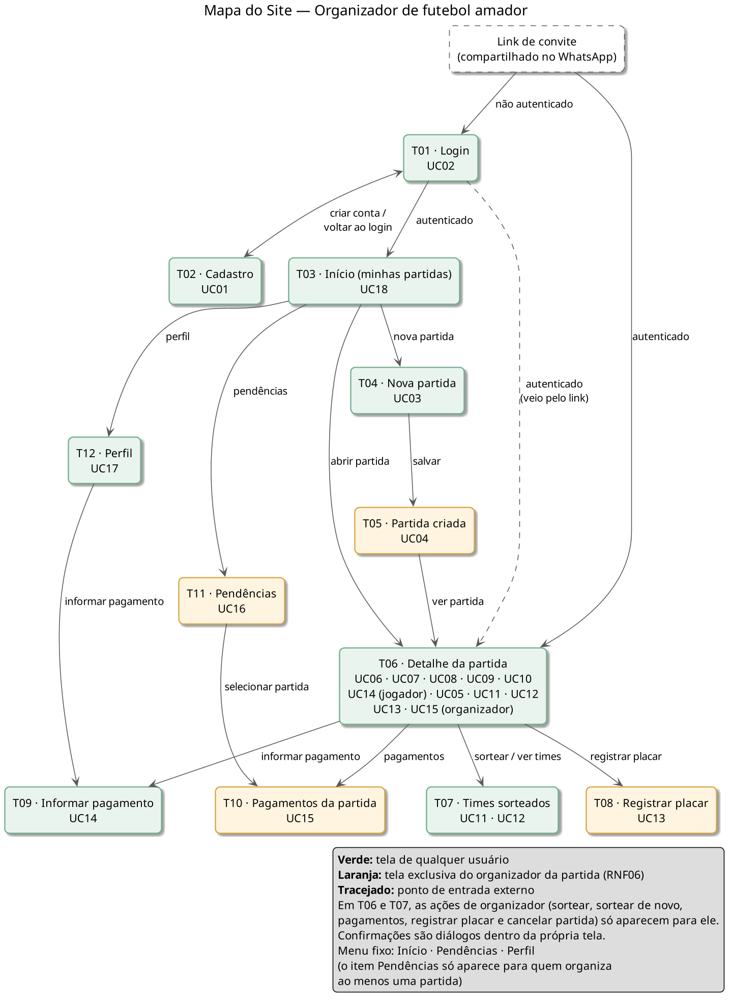

> Fonte do diagrama (PlantUML): [mapa_do_site.puml](diagramas/mapa_do_site.puml)

O mapa do site apresenta as 12 telas do sistema e a navegação entre elas. Cada tela indica os casos de uso que atende, de forma que todos os casos de uso do diagrama possuem ao menos uma tela correspondente. Os casos de uso sem ator direto aparecem como estados de outras telas: UC04 na tela T05, UC08 e UC10 na tela T06 e UC12 no diálogo de sorteio da T06 e na T07.

**Pontos de entrada**

- **Link de convite** (compartilhado no WhatsApp): é a entrada principal dos jogadores (RF04, RF06). Usuários autenticados vão direto para o detalhe da partida (T06); os demais passam pelo login (T01) e, em seguida, são levados à partida do link (UC02).
- **Acesso direto ao sistema:** após o login, o usuário chega ao Início (T03), com suas próximas partidas (UC18).

**Navegação e permissões**

- As telas em laranja são exclusivas do organizador da partida (RNF06): Partida criada, Registrar placar, Pagamentos da partida e Pendências. A tela Nova partida é aberta a qualquer usuário autenticado, porque quem cria a partida passa a ser o organizador dela. Nas telas T06 e T07, os botões de organizador (sortear, sortear de novo, pagamentos da partida, registrar placar e cancelar partida) só aparecem para ele.
- O menu fixo das telas autenticadas tem Início, Pendências e Perfil; o item Pendências só aparece para quem organiza ao menos uma partida.
- Confirmações de ações (cancelar partida, cancelar presença e sortear times) são diálogos dentro da própria tela, e não telas separadas.

## 12. Telas

O protótipo foi feito para celular (RNF01), já que o acesso principal acontece pelo link compartilhado no WhatsApp. Clique em uma tela para vê-la em tamanho real. As telas seguem o mapa do site (seção 11). A tela T06 tem variações que mostram a mesma tela em situações diferentes da partida e na visão de cada tipo de usuário. Os diálogos de confirmação aparecem junto da tela em que são abertos.

Partida de exemplo usada nas telas: society na quinta-feira, 10/12, às 20h, na Arena Society Centro, com 14 titulares, 2 reservas e quadra de R$ 280,00, o que dá R$ 280,00 ÷ 16 = R$ 17,50 por jogador (RN03).

### Acesso

| Tela | Descrição | Casos de uso | Acessada por |
|---|---|---|---|
| <a href="prototipo/T01_login.png">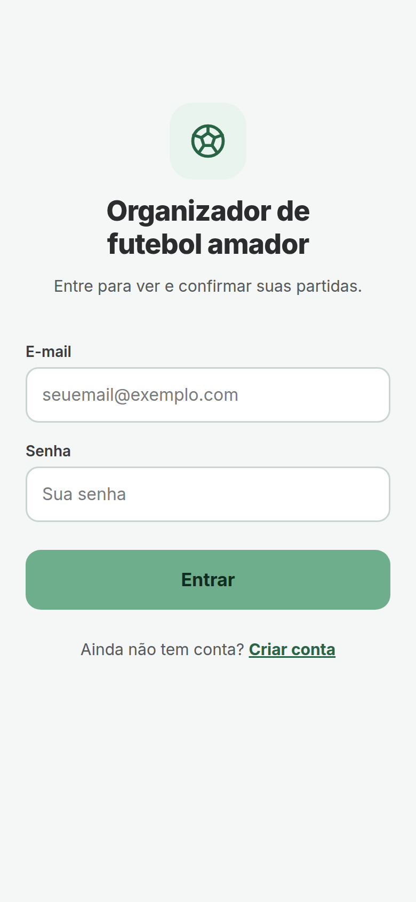</a> | **T01 · Login.** E-mail e senha, além do link "Criar conta". Quem chega pelo link de convite sem estar autenticado passa por aqui e depois é levado à partida. | UC02 | Link de convite; T02 |
| <a href="prototipo/T02_cadastro.png">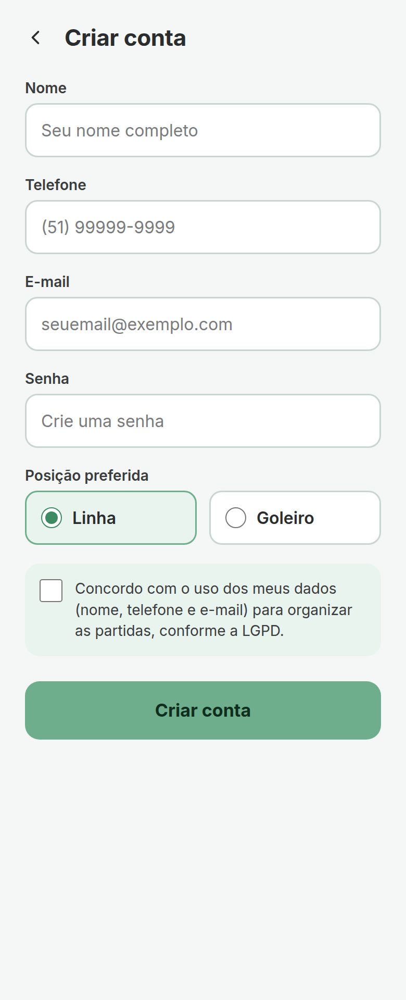</a> | **T02 · Cadastro.** Nome, telefone, e-mail, senha, posição preferida (linha ou goleiro) e aceite do uso dos dados conforme a LGPD (RS01). | UC01 | T01 |
| <a href="prototipo/T03_inicio.png">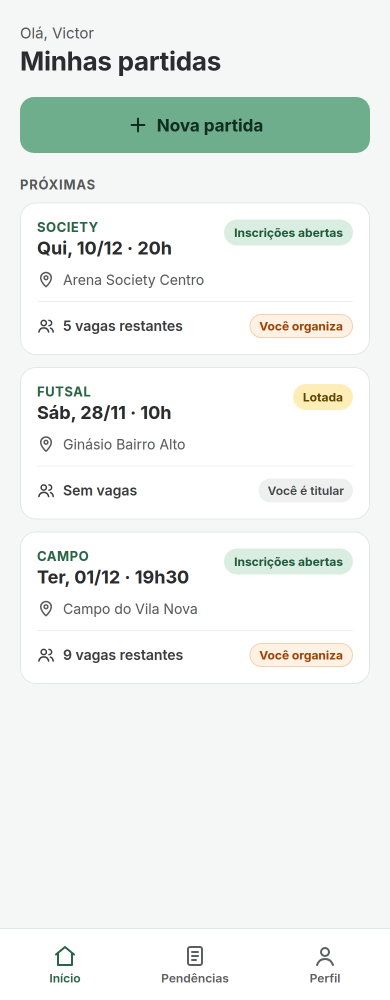</a> | **T03 · Início (Minhas partidas).** Próximas partidas em que o usuário está inscrito ou que organiza, com data, local, modalidade, situação e vagas restantes. As partidas que ele organiza são identificadas. Botão "Nova partida". | UC18 | T01; menu |

### Criação da partida

| Tela | Descrição | Casos de uso | Acessada por |
|---|---|---|---|
| <a href="prototipo/T04_nova_partida.png">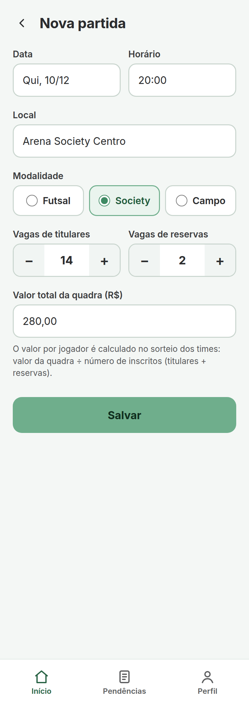</a> | **T04 · Nova partida.** Data, horário, local, modalidade, vagas de titulares e de reservas e valor total da quadra, com a explicação de como o valor por jogador é calculado. Aberta a qualquer usuário autenticado: quem cria a partida passa a ser o organizador dela. | UC03 | T03 |
| <a href="prototipo/T05_partida_criada.png">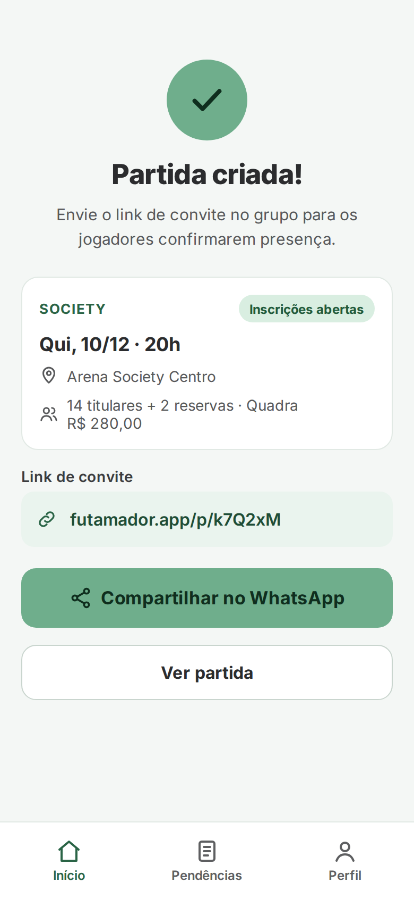</a> | **T05 · Partida criada.** Resumo da partida, link de convite gerado, botão "Compartilhar no WhatsApp" e botão "Ver partida", que leva ao detalhe da partida (T06d). | UC04 | T04 |

### Detalhe da partida (T06) e suas variações

| Tela | Descrição | Casos de uso | Acessada por |
|---|---|---|---|
| <a href="prototipo/T06a_detalhe_nao_inscrito.png">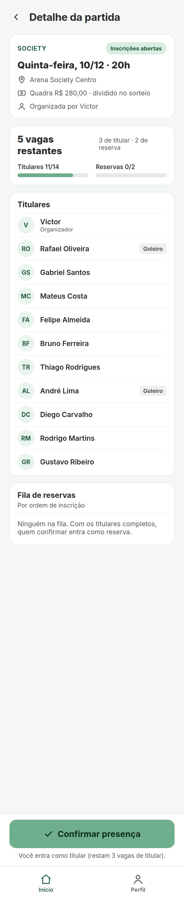</a> | **T06a · Jogador ainda não inscrito.** Dados da partida, vagas restantes, titulares e fila de reservas. O botão "Confirmar presença" fica fixo no rodapé e inscreve o jogador com um toque (RNF02). | UC06, UC07 | Link de convite |
| <a href="prototipo/T06b_detalhe_reserva.png">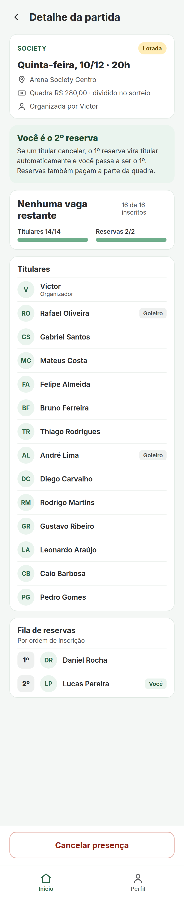</a> <a href="prototipo/T06b_modal_cancelar_presenca.png">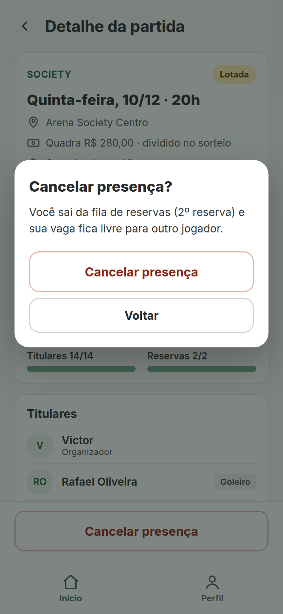</a> | **T06b · Jogador inscrito como reserva, partida *Lotada*.** Mostra a posição na fila ("Você é o 2º reserva") e explica que o primeiro reserva vira titular automaticamente quando um titular cancela. Ao lado, o diálogo de "Cancelar presença". | UC06, UC08, UC09, UC10 | T03 |
| <a href="prototipo/T06c_detalhe_lotada.png">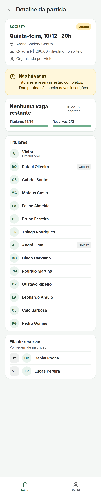</a> | **T06c · Partida lotada.** Para quem não está inscrito, o sistema informa que titulares e reservas estão completos e não oferece a opção de confirmar presença (RN01). | UC06, UC07 (FE01) | Link de convite |
| <a href="prototipo/T06d_detalhe_organizador.png">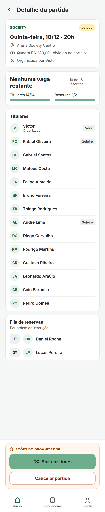</a> <a href="prototipo/T06d_modal_sortear_times.png">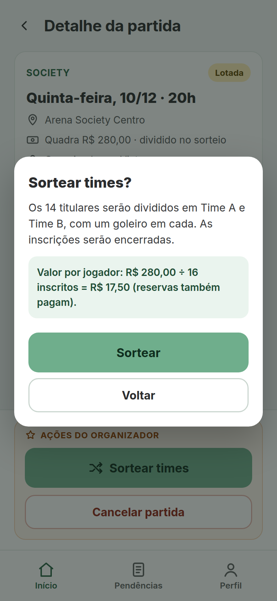</a> <a href="prototipo/T06d_modal_cancelar_partida.png">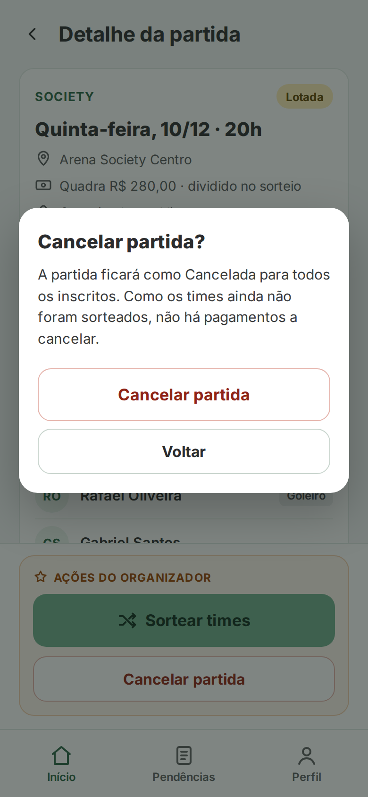</a> | **T06d · Visão do organizador antes do sorteio.** Bloco "Ações do organizador" com "Sortear times" e "Cancelar partida" (RNF06). O diálogo de sorteio mostra o cálculo do valor por jogador e avisa que as inscrições serão encerradas (RN05). O diálogo de cancelamento avisa que a partida ficará cancelada para todos; como ainda não houve sorteio, não há pagamentos a cancelar. Victor também é titular e, por herança, poderia cancelar a própria presença e informar o próprio pagamento; essas ações ficam fora destas telas de exemplo para destacar as ações de organizador. | UC05, UC06, UC11, UC12 | T03; T05 |
| <a href="prototipo/T06e_detalhe_organizador_times_sorteados.png">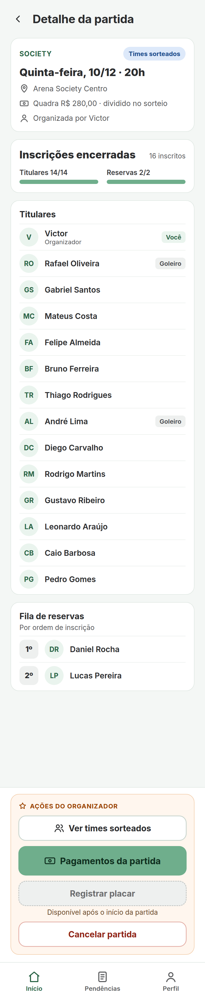</a> | **T06e · Visão do organizador após o sorteio.** Inscrições encerradas, com "Ver times sorteados", "Pagamentos da partida", "Registrar placar" (desabilitado até o horário da partida) e "Cancelar partida", que nesta situação também cancela os pagamentos não confirmados (RN08). | UC05, UC06, UC13, UC15 | T03 |
| <a href="prototipo/T06f_detalhe_reserva_times_sorteados.png">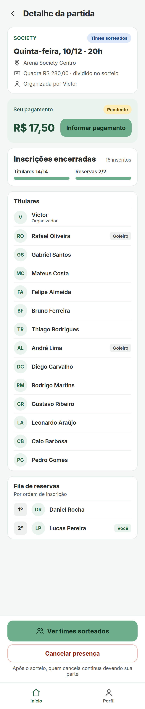</a> | **T06f · Visão do jogador após o sorteio.** Card com o valor da sua parte e o botão "Informar pagamento", além de "Ver times sorteados". "Cancelar presença" avisa que, após o sorteio, quem cancela continua devendo sua parte (RN04). | UC06, UC09, UC14 | T03 |

### Jogo e pagamentos

| Tela | Descrição | Casos de uso | Acessada por |
|---|---|---|---|
| <a href="prototipo/T07_times_sorteados.png">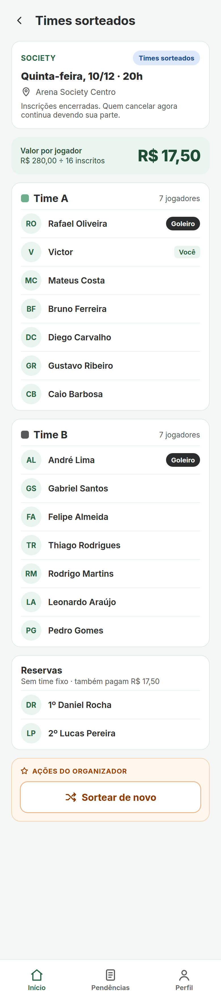</a> <a href="prototipo/T07_modal_sortear_de_novo.png">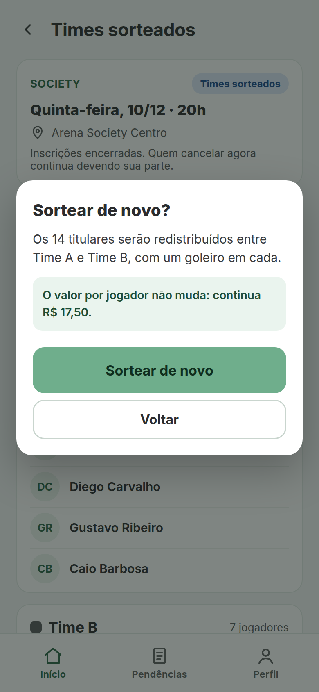</a> | **T07 · Times sorteados.** Time A e Time B com 7 jogadores cada e um goleiro em cada time (RN06, RN07), reservas sem time fixo e valor por jogador. O organizador pode sortear de novo; o diálogo informa que o valor não muda (RN03). | UC06 (FA01), UC11, UC12 | T06d, T06e, T06f |
| <a href="prototipo/T08_registrar_placar.png">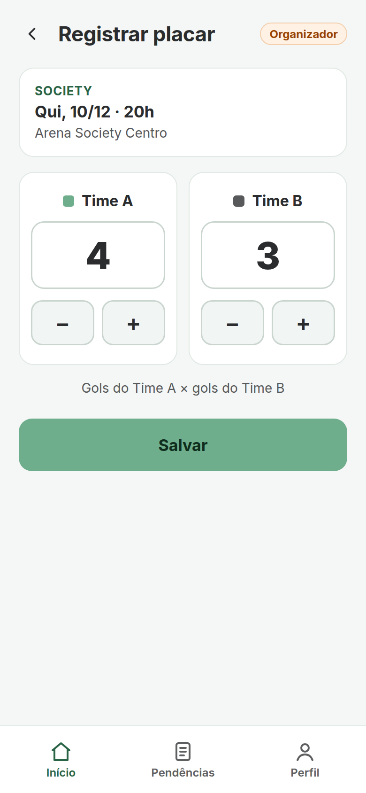</a> | **T08 · Registrar placar (organizador).** Gols do Time A e do Time B. Ao salvar, a partida é encerrada. | UC13 | T06e |
| <a href="prototipo/T09_informar_pagamento.png">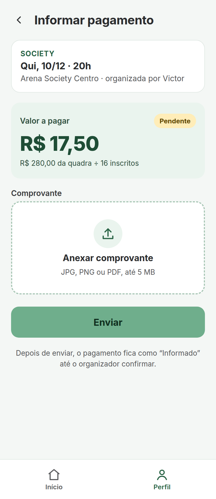</a> | **T09 · Informar pagamento.** Valor a pagar, situação do pagamento e envio do comprovante (JPG, PNG ou PDF, até 5 MB — RNF07). Depois do envio, o pagamento fica *Informado* até a confirmação do organizador. | UC14 | T06f; T12 |
| <a href="prototipo/T10_pagamentos_da_partida.png">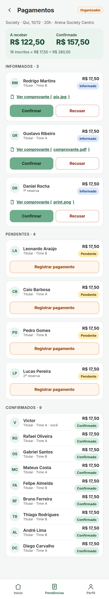</a> | **T10 · Pagamentos da partida (organizador).** Total a receber e confirmado, e a lista de inscritos agrupada por situação. Pagamentos *Informados* podem ser confirmados ou recusados depois de ver o comprovante; os *Pendentes* podem ser registrados manualmente. | UC15 | T06e; T11 |
| <a href="prototipo/T11_pendencias.png">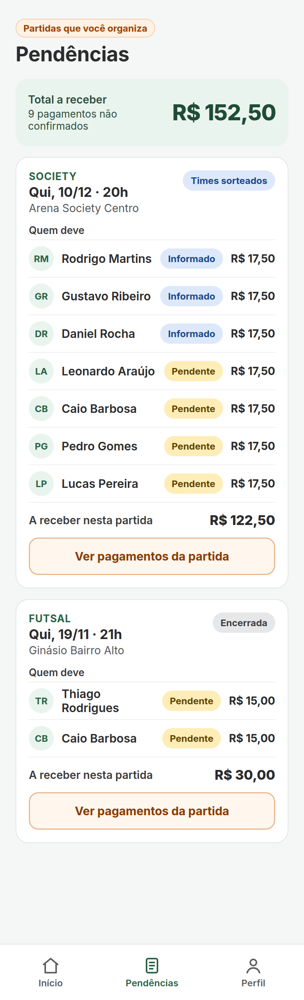</a> | **T11 · Pendências (organizador).** Total a receber de todas as partidas que o usuário organiza e, para cada partida, quem ainda deve e quanto. | UC16 | Menu (só para quem organiza partidas) |
| <a href="prototipo/T12_perfil.png">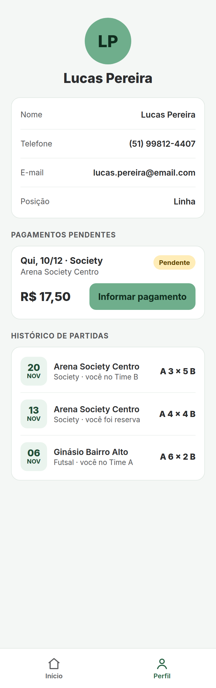</a> | **T12 · Perfil.** Dados do jogador, pagamentos pendentes com atalho para informar o pagamento e histórico de partidas encerradas, com local, time (ou "reserva") e placar. | UC17 | Menu |

**Cobertura dos casos de uso:** todos os 18 casos de uso têm ao menos uma tela. Os casos de uso sem ator direto aparecem como parte de outras telas: UC04 (link de convite) na T05, UC08 (entrar como reserva) e UC10 (promover reserva) na T06b, e UC12 (calcular valor) no diálogo de sorteio da T06d e na T07.

---

## 13. Considerações Finais

### 13.1 Principais desafios

- **Delimitar o escopo.** A primeira versão da ideia tinha grupos fixos, partidas recorrentes, mensalistas e avulsos, nota de nível para equilibrar o sorteio e bloqueio de inadimplentes. Cada um desses itens trazia classes e regras novas (uma partida recorrente gerando instâncias, uma avaliação de nível que alguém precisaria manter). Para manter o domínio pequeno e bem modelado, o sistema ficou centrado na partida avulsa compartilhada por link de convite, e o restante foi registrado como fora do escopo (seção 1.4).
- **Escrever regras de negócio verificáveis.** A primeira versão da RN04 dizia que o jogador que cancelasse com menos de 12 horas de antecedência, e cuja vaga não fosse preenchida, continuaria devendo. A regra dependia de um prazo arbitrário e de algo que só se sabe depois (se alguém ocupou a vaga). Ela foi reescrita para depender de um evento claro, o sorteio dos times, e foi amarrada à RN03: o valor por jogador é calculado no primeiro sorteio, e um novo sorteio não o altera.
- **Modelar a máquina de estados da Partida.** O rascunho tinha estados como *Lista fechada* e *Em andamento*, mas nenhum ator ou evento do sistema provocava essas transições. A solução foi tratar o início da partida como uma guarda de tempo (`dataHora`) e não como um estado. Também foi preciso garantir que nenhum estado ficasse sem saída, o que levou à transição de cancelamento a partir de qualquer estado de *Em preparação* e à RN08 (o que acontece com os pagamentos de uma partida cancelada).
- **Manter os artefatos coerentes entre si.** Cada mudança em um artefato pedia mudanças nos outros. Ao montar o mapa do site, ficou evidente que a tela inicial, com as próximas partidas do usuário, não correspondia a nenhum requisito nem caso de uso. Isso gerou o RF17 e o UC18, que precisaram ser propagados para o diagrama de casos de uso, o diagrama de classes de domínio e o documento de requisitos.

### 13.2 Aprendizados

- **Os artefatos de projeto validam os de análise.** Os erros mais importantes não apareceram quando cada artefato foi feito, e sim no artefato seguinte: a máquina de estados expôs pré-condições vagas nos casos de uso ("a partida ainda não foi iniciada"), e o protótipo expôs um caso de uso que faltava. Por isso, análise e projeto funcionam melhor como um ciclo de revisão do que como uma sequência de etapas.
- **Rastreabilidade nos dois sentidos.** Manter tabelas que ligam requisito → caso de uso → classe/método → tela facilitou encontrar o que estava faltando e o que estava sobrando. Um método sem caso de uso, ou uma tela sem requisito, é sinal de que algo precisa ser revisto.
- **Decisões de modelagem precisam de justificativa.** A navegabilidade das associações, o uso de *include* e *extend* e os casos de uso sem ator direto (UC04, UC08, UC10 e UC12) ficaram mais fáceis de definir quando cada escolha foi ligada a um caso de uso concreto que precisava dela.
- **Diagramas como texto.** Usar PlantUML permitiu versionar os diagramas no Git junto com a documentação e ver, pelo histórico de commits, como o modelo evoluiu.

### 13.3 Melhorias futuras

- Pagamento online integrado (Pix ou cartão), com confirmação automática no lugar do envio de comprovante.
- Notificações por WhatsApp, e-mail ou push: aviso ao reserva promovido a titular, lembrete da partida e cobrança de pagamentos pendentes.
- Grupos fixos com partidas recorrentes e controle de mensalistas e avulsos.
- Sorteio equilibrado a partir de uma avaliação de nível dos jogadores.
- Estatísticas dos jogadores (gols, presença, vitórias) a partir dos placares registrados.
- Reserva de quadra junto ao dono do espaço e organização de campeonatos.

## 14. Referências

### Bibliografia

- BEZERRA, Eduardo. *Princípios de análise e projeto de sistemas com UML*. 3. ed. Rio de Janeiro: Elsevier, 2014. Base do modelo de especificação de caso de uso da disciplina.
- BOOCH, Grady; RUMBAUGH, James; JACOBSON, Ivar. *UML: guia do usuário*. 2. ed. Rio de Janeiro: Elsevier, 2012.
- BRASIL. Lei nº 13.709, de 14 de agosto de 2018. Lei Geral de Proteção de Dados Pessoais (LGPD). *Diário Oficial da União*, Brasília, DF, 15 ago. 2018. Base do requisito suplementar RS01.
- FOWLER, Martin. *UML essencial: um breve guia para a linguagem-padrão de modelagem de objetos*. 3. ed. Porto Alegre: Bookman, 2005.
- GUEDES, Gilleanes T. A. *UML 2: uma abordagem prática*. São Paulo: Novatec, 2009.
- INVERNISI, Mateus de Freitas. *Análise e Projeto de Sistemas*: material de aula, modelo do Documento de Requisitos e modelo de Especificação de Caso de Uso. Passo Fundo: IFSul, 2026.
- PRESSMAN, Roger S. *Engenharia de software: uma abordagem profissional*. 7. ed. Porto Alegre: AMGH, 2011.
- SOMMERVILLE, Ian. *Engenharia de software*. 9. ed. São Paulo: Pearson, 2011.

### Ferramentas

| Finalidade | Ferramenta |
|---|---|
| Diagramas UML (casos de uso, classes, máquina de estados) e mapa do site | PlantUML |
| Protótipo das telas | Claude Design (canvas no claude.ai), com as telas exportadas em PNG |
| Documento de requisitos no modelo da disciplina | Gerado com o Claude a partir do modelo e conferido no LibreOffice Writer |
| Versionamento | Git e GitHub |

### Uso de inteligência artificial

Foram usados o Claude (Anthropic, modelo Claude Opus 5.5), pelo Claude Code, e o Claude Design, como apoio em todas as etapas: levantamento de ideias, redação e revisão de requisitos e casos de uso, código PlantUML dos diagramas, geração do Documento de Requisitos, protótipo das telas e revisões de coerência entre os artefatos. A declaração completa, com o que ficou a cargo do aluno e o aprendizado obtido, está no [README](README.md#declaração-de-uso-de-ia).
