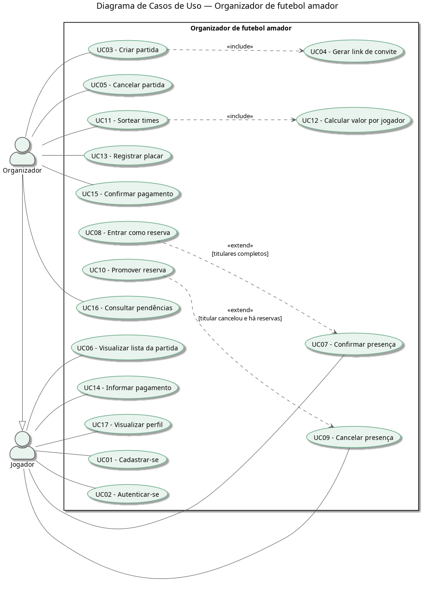

# Documentação do Projeto — Organizador de futebol amador

# Parte I — Documento de Especificação de Requisitos

> Versão no modelo da disciplina: [Documento_de_Requisitos.docx](documentos/Documento_de_Requisitos.docx)

| | |
|---|---|
| **Projeto / Sistema:** | Organizador de futebol amador |
| **Cliente / Solicitante:** | Prof. Mateus de Freitas Invernisi (APS - IFSUL) |
| **Responsável(is):** | Victor Hugo Andreon de Camargo |
| **Data:** | 04/11/2026 |
| **Versão:** | 1.0 |

## 1. Introdução

### 1.1 Sobre este documento

Este documento tem como objetivo apresentar e organizar os requisitos levantados para o sistema, servindo de referência para as etapas de projeto, desenvolvimento, testes e validação.

### 1.2 Descrição do Mini-Mundo

Hoje, as partidas de futebol amador são marcadas geralmente pelo WhatsApp, tanto no contato com a quadra quanto com os jogadores da pelada. A lista surge da vontade de jogar: alguém (o organizador) cria uma lista simples com a data e o local no cabeçalho, como "Futebol (data) — 1 - Jogador1; 2 - Jogador2", e o pessoal vai preenchendo.

Quando a lista lota, geralmente com 14 jogadores (futebol 7), ainda são aceitos 2 jogadores como reserva. Depois disso, o pessoal pede para que não escrevam mais seus nomes na lista. Quando alguém desiste, a pessoa retira o nome da lista e fica o vazio para alguém preencher, sem nenhuma ordem definida de quem entra no lugar.

A divisão dos times é feita na hora, por sorteio aleatório em um sorteador online.

O pagamento geralmente é avulso: a pessoa que coordena a lista paga a quadra e depois cobra de cada jogador individualmente. É usada a mesma lista do jogo, só que para pagamento: o jogador paga, coloca o emoji de certo ao lado do nome e envia o comprovante para quem pagou a quadra (no melhor dos casos). Na prática, o organizador tem que ficar cobrando quem ainda não pagou.

Os principais envolvidos são o **organizador**, que cria a lista, contata a quadra, paga e cobra os jogadores, e os **jogadores**, que se inscrevem, desistem e pagam sua parte. As informações relevantes são a partida (data, horário e local), a lista de jogadores e reservas, os times sorteados e quem pagou ou está devendo.

### 1.3 Propósito do Sistema

O propósito é auxiliar e facilitar a manutenção e organização dessas partidas, fazendo com que o controle da lista seja mais fácil, tanto no controle dos pagamentos quanto no sorteio dos times, registros das partidas, etc. Espera-se que o organizador tenha uma visão clara de quem confirmou, quem desistiu e quem está devendo, sem depender de mensagens soltas no WhatsApp, e que as vagas deixadas por desistências sejam preenchidas automaticamente pelos reservas.

## 2. Requisitos Funcionais

| ID | Descrição | Prioridade | Depende de |
|---|---|---|---|
| RF01 | O sistema deve permitir que o usuário se cadastre informando nome, telefone, e-mail, senha e posição preferida (linha ou goleiro). | Alta | — |
| RF02 | O sistema deve permitir que o usuário cadastrado se autentique com e-mail e senha. | Alta | RF01 |
| RF03 | O sistema deve permitir que o organizador crie uma partida informando data, horário, local, modalidade (futsal, society ou campo), número de vagas para titulares, número de vagas para reservas e valor total da quadra. | Alta | RF02 |
| RF04 | O sistema deve gerar um link de convite para cada partida, que o organizador pode compartilhar com os jogadores. | Alta | RF03 |
| RF05 | O sistema deve permitir que o organizador cancele uma partida que ainda não foi iniciada. | Média | RF03 |
| RF06 | O sistema deve permitir que o jogador confirme presença em uma partida por meio do link de convite. | Alta | RF02, RF04 |
| RF07 | O sistema deve inscrever o jogador como reserva quando todas as vagas de titulares da partida estiverem preenchidas. | Alta | RF06 |
| RF08 | O sistema deve permitir que o jogador cancele sua presença em uma partida. | Alta | RF06 |
| RF09 | O sistema deve promover automaticamente o primeiro reserva da fila para titular quando um titular cancelar sua presença. | Alta | RF07, RF08 |
| RF10 | O sistema deve exibir a lista da partida com titulares, reservas e quantidade de vagas restantes. | Alta | RF06 |
| RF11 | O sistema deve permitir que o organizador sorteie aleatoriamente os times entre os titulares confirmados. | Alta | RF06 |
| RF12 | O sistema deve permitir que o jogador informe o pagamento de sua parte anexando o comprovante. | Média | RF06 |
| RF13 | O sistema deve permitir que o organizador confirme ou registre manualmente o pagamento de um jogador. | Alta | RF06 |
| RF14 | O sistema deve exibir ao organizador a lista de jogadores com pagamento pendente em cada partida. | Alta | RF13 |
| RF15 | O sistema deve permitir que o organizador registre o placar final da partida. | Média | RF11 |
| RF16 | O sistema deve exibir o perfil do jogador com seu histórico de partidas disputadas e pendências financeiras. | Baixa | RF15 |

## 3. Requisitos Não Funcionais

| ID | Descrição | Categoria | Prioridade | Depende de |
|---|---|---|---|---|
| RNF01 | O sistema deve ter interface responsiva, adaptada para uso em smartphones, já que o acesso principal ocorre pelo link compartilhado no WhatsApp. | Usabilidade | Alta | RF04 |
| RNF02 | O jogador deve conseguir confirmar presença em no máximo 2 toques após abrir o link de convite, estando autenticado. | Usabilidade | Média | RF06 |
| RNF03 | O sistema deve processar a confirmação e o cancelamento de presença em no máximo 2 segundos. | Desempenho | Média | RF06, RF08 |
| RNF04 | Confirmações de presença simultâneas não podem resultar em mais inscritos do que o número de vagas da partida. | Confiabilidade | Alta | RF06, RF07 |
| RNF05 | As senhas dos usuários devem ser armazenadas de forma criptografada (hash), nunca em texto puro. | Segurança | Alta | RF01 |
| RNF06 | Apenas o organizador da partida pode cancelá-la, sortear os times, confirmar pagamentos e registrar o placar. | Segurança | Alta | RF05, RF11, RF13, RF15 |
| RNF07 | O comprovante de pagamento deve ser aceito nos formatos JPG, PNG ou PDF, com tamanho máximo de 5 MB. | Interface | Baixa | RF12 |

## 4. Regras de Negócio

| ID | Descrição | Prioridade | Depende de |
|---|---|---|---|
| RN01 | Uma partida não aceita mais titulares do que o número de vagas definido. Com os titulares completos, novos inscritos entram como reservas; com as reservas também completas, novas inscrições não são aceitas. | Alta | RF06, RF07 |
| RN02 | A fila de reservas segue a ordem de inscrição: quem se inscreveu primeiro é o primeiro a ser promovido a titular. | Alta | RF07, RF09 |
| RN03 | O valor a ser pago por cada jogador é o valor total da quadra dividido pelo número de inscritos (titulares e reservas) no momento do sorteio dos times, arredondado para cima no centavo. Os reservas também pagam, pois revezam com os titulares durante a partida. | Alta | RF03, RF11, RF13 |
| RN04 | O jogador que cancelar sua presença com menos de 12 horas de antecedência e cuja vaga não for preenchida por outro jogador continua responsável pelo pagamento da sua parte. | Média | RF08, RF09, RN03 |
| RN05 | Após o sorteio dos times, as inscrições da partida são encerradas e não são aceitas novas confirmações. | Alta | RF06, RF11 |
| RN06 | No sorteio, os jogadores com posição preferida de goleiro devem ser distribuídos um por time, enquanto houver goleiros disponíveis. | Média | RF01, RF11 |

## 5. Requisitos Suplementares

| ID | Descrição | Categoria | Prioridade | Depende de |
|---|---|---|---|---|
| RS01 | O sistema deve estar em conformidade com a LGPD no tratamento dos dados pessoais dos usuários (nome, telefone e e-mail). | Legal | Média | RF01 |
| RS02 | O sistema deve ser acessado pelo navegador, sem necessidade de instalação de aplicativo. | Instalação | Média | RF04 |
| RS03 | A interface do sistema deve estar em português brasileiro. | Internacionalização | Baixa | — |

---

# Parte II — Casos de Uso

## 6. Diagrama de Casos de Uso

> Fonte do diagrama (PlantUML): [casos_de_uso.puml](diagramas/casos_de_uso.puml)

**Atores**

| Ator | Descrição |
|---|---|
| Jogador | Usuário que se inscreve nas partidas, cancela sua presença, informa pagamentos e acompanha seu perfil. |
| Organizador | Jogador responsável por criar e gerenciar a partida: sorteia os times, confirma pagamentos e registra o placar. Herda todos os casos de uso do Jogador (generalização). |

**Rastreabilidade: casos de uso × requisitos**

| Caso de uso | Ator(es) | Requisitos / Regras |
|---|---|---|
| UC01 - Cadastrar-se | Jogador | RF01 |
| UC02 - Autenticar-se | Jogador | RF02 |
| UC03 - Criar partida | Organizador | RF03 |
| UC04 - Gerar link de convite | — (incluído em UC03) | RF04 |
| UC05 - Cancelar partida | Organizador | RF05 |
| UC06 - Visualizar lista da partida | Jogador | RF10 |
| UC07 - Confirmar presença | Jogador | RF06, RN01, RN05 |
| UC08 - Entrar como reserva | — (estende UC07) | RF07, RN01 |
| UC09 - Cancelar presença | Jogador | RF08, RN04 |
| UC10 - Promover reserva | — (estende UC09) | RF09, RN02 |
| UC11 - Sortear times | Organizador | RF11, RN05, RN06 |
| UC12 - Calcular valor por jogador | — (incluído em UC11) | RN03 |
| UC13 - Registrar placar | Organizador | RF15 |
| UC14 - Informar pagamento | Jogador | RF12 |
| UC15 - Confirmar pagamento | Organizador | RF13 |
| UC16 - Consultar pendências | Organizador | RF14 |
| UC17 - Visualizar perfil | Jogador | RF16 |

## 7. Documentação dos Casos de Uso

---

# Parte III — Modelagem

## 8. Diagrama de Classes — Modelo Conceitual

## 9. Diagrama de Classes — Modelo de Domínio

## 10. Segundo Diagrama UML

---

# Parte IV — Protótipo

## 11. Mapa do Site

## 12. Telas

---

## 13. Considerações Finais

## 14. Referências
