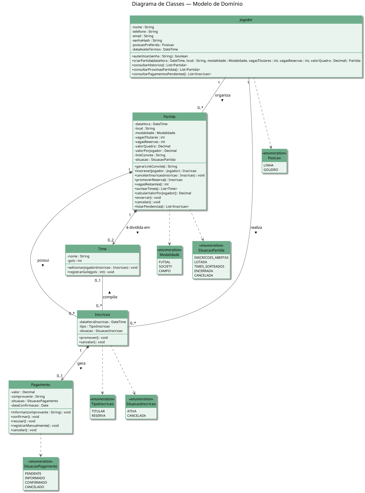

# Organizador de futebol amador

**Disciplina:** Análise e Projeto de Sistemas (APS) — Bacharelado em Ciência da Computação — IFSUL  
**Aluno:** Victor Hugo Andreon de Camargo  
**Professor:** Mateus de Freitas Invernisi

## Descrição do sistema

Sistema responsável por gerenciar e organizar partidas de futebol amador, como futsal, society e campo. A ideia é auxiliar os organizadores dessas partidas a terem mais controle sobre elas: quem participa? quem pagou? quem está devendo? em que campo? quantos jogadores? etc.

O problema principal é que geralmente não há uma maneira centralizada de realizar esse controle, muitas vezes sendo no “vamos ver”, “puxa a lista no whats”, etc. Assim, a responsabilidade fica com cada jogador, e o organizador não tem uma visão clara de quem confirmou, quem desistiu e quem está devendo.

O sistema é voltado para organizadores e jogadores de partidas de futebol amador.

As principais funcionalidades são: criação das partidas, inscrição de jogadores, com fila de reservas quando as vagas de titulares estiverem completas, sorteio automático para a divisão dos times, registro e controle de pagamentos, placares das partidas e perfis de jogadores.

## Diagrama de classes

## Documentação

A documentação completa de análise e projeto (requisitos, casos de uso, diagramas e protótipo) está em [Documentação do Projeto.md](Documentação%20do%20Projeto.md).

## Conclusão / Aprendizado

**Dificuldades e como foram resolvidas**

- **Escopo grande demais no começo.** A ideia inicial tinha grupos fixos, partidas recorrentes, mensalistas e sorteio equilibrado por nível. Reduzi o sistema à partida avulsa compartilhada por link de convite e deixei o resto como melhoria futura.
- **Regras de negócio difíceis de verificar.** A RN04 dependia de um prazo de 12 horas e de a vaga ser preenchida ou não. Reescrevi a regra para depender do sorteio dos times, que é um evento claro, e a liguei ao cálculo do valor por jogador (RN03).
- **Máquina de estados com estados que nada provocava.** Estados como *Em andamento* não tinham evento que os disparasse. Passei a tratar o horário da partida como uma condição de tempo e garanti que nenhum estado ficasse sem saída.
- **Manter tudo coerente.** O protótipo mostrou que a tela inicial não tinha caso de uso. Criei o RF17 e o UC18 e atualizei os diagramas e documentos afetados.

**Principais aprendizados**

- Cada artefato revisa o anterior: a máquina de estados corrigiu os casos de uso, e o protótipo corrigiu os requisitos.
- A rastreabilidade (requisito → caso de uso → classe → tela) é o que permite encontrar o que falta ou sobra no modelo.
- Toda decisão de modelagem (navegabilidade, *include*/*extend*, atores) fica mais fácil de defender quando está ligada a um caso de uso concreto.

As considerações finais completas estão na [seção 13 da documentação](Documentação%20do%20Projeto.md#13-considerações-finais).

## Declaração de uso de IA

Usei inteligência artificial ao longo de todo o trabalho, como apoio para escrever, revisar e montar os artefatos. As decisões sobre o sistema foram minhas, e revisei cada artefato antes de entregar.

| | |
|---|---|
| **Ferramentas** | Claude (Anthropic), pelo Claude Code no aplicativo desktop, e Claude Design, para o protótipo das telas |
| **Modelo** | Claude Opus 5.5 |
| **Etapas em que foi usada** | Levantamento de temas e ideias; redação e revisão dos requisitos, das regras de negócio e das especificações dos casos de uso no modelo da disciplina; código PlantUML de todos os diagramas; geração do Documento de Requisitos (.docx) no modelo; protótipo das telas no Claude Design; revisões de coerência entre os artefatos; rascunho das considerações finais, das referências e desta declaração |
| **O que ficou comigo** | Escolha do tema entre as opções levantadas; decisões de domínio (quem pode criar partida, quando o jogador continua devendo, o que fica fora do escopo); aprovação ou recusa de cada sugestão; leitura e estudo de cada artefato, incluindo a revisão do repositório commit a commit, em que encontrei inconsistências entre a tabela de rastreabilidade e os casos de uso |

**Aprendizado com o uso**

- **A IA acelera, mas não garante coerência.** Ela escreve rápido e bem, mas errou em pontos que eu só vi revisando: depois de corrigir um requisito (RF05), um caso de uso continuou com o texto antigo, e um rascunho da conclusão afirmava que itens estavam na seção de escopo quando não estavam. Aprendi a conferir cada mudança no documento inteiro, e não só no lugar em que ela foi feita.
- **Serve muito bem como revisora.** Pedir uma revisão cruzada (requisito × caso de uso × classe × tela) encontrou contradições que eu não tinha visto, como pré-condições que proibiam o próprio fluxo alternativo e uma navegabilidade que não permitia montar uma tela. Mas cada achado precisou ser confirmado no arquivo antes de corrigir.
- **Ela não substitui entender a matéria.** Durante o trabalho eu confundi *include* com *extend*, e só ao estudar a resposta e o exemplo do professor entendi que o *include* é sempre executado e o *extend* é condicional. Também foi comparando com o exemplo de aula que percebi que os fluxos alternativos precisavam de subpassos numerados e do passo de retorno.
- **É preciso controlar o que ela faz.** Em um commit, a ferramenta se colocou como coautora sem eu pedir; corrigi o histórico e deixei a regra configurada. Usar IA exige revisar também o que ela faz por conta própria, e não só o texto que ela produz.
